# Window catio concepts

A ground-supported timber enclosure connects a souterrain apartment window to the lawn. A removable insert in the window
recess carries a small cat port; standard tunnel elements run from it to one or more enclosures standing on the lawn, each
with a continuous mesh floor, a landing and ramp inside, and a maintenance door to the garden.

## Where the catio is designed

Open **Catio concept** in the CanFactory header or the **Window catio** card in the model library: `#/concepts/catio`. That
page is a short overview. It links to:

- **The catio planner**, `#/concepts/catio/planner` ([planner/](planner/README.md), #109), where the whole catio is designed.
  It places the window, the enclosures and the tunnels between them in the garden. The selected window's inspector sets the
  window's glass and sash, the cat ports' clear size, their closure and the doors' seat.
- **Each sub-assembly's page**, with its pieces, joints, staged assembly and parts list (below).

The planner's project, saved in the browser, is the one source for the design. The sub-assembly pages take the window's
sizes and the cat ports' settings from it (`plannerCatPorts` in
[catioSaved.ts](../../../apps/web/src/catioSaved.ts)).

The concept page had two modes, Direct (the original design, on the window) and Modular (a tunnel to one or two
enclosures). The planner replaced both in #116. Its **Import my existing catio** action makes a new planner project, once,
from what that page saved in this browser (`canfactory.catio.v1`, settings versions 1 to 3, and the sub-assembly pages' own
saves), using [catioLegacyImport.ts](../../../apps/web/src/catioLegacyImport.ts):

- **Window and cat ports.** The window's sizes, the cat ports' clear size, their closure and the doors' seat are imported.
  - A version 1 design keeps the sliding gates it was drawn with.
  - A tunnel saved with a different clear width and height takes the larger size both ways.
  - A design saved before the doors' seat could be chosen has stop strips.
- **Layout.** Enclosure A stands at the end of the saved route: straight, or offset left or right with two side-port turns.
  An enclosure B stands at the end of a link from A's right-hand port. The garden is enlarged to fit them.
- **Sub-assembly settings.** The pages' saved settings become the project's insert, couplings and mesh, and the tunnels'
  feet.
- **The old saves.** The import only reads them. They stay in the browser as they were, and nothing else reads
  `canfactory.catio.v1`.
- **Not imported.** How the old page was viewed (camera, layers, doors, assembly stage) is not part of a planner project.
  A Direct-mode save gets the modular design's sizes, since the planner always builds the catio with a tunnel.

For local development:

```sh
npm run dev --workspace @canfactory/web -- --port 5181
```

Then open <http://127.0.0.1:5181/#/concepts/catio>. The overview, the planner and the sub-assembly pages work without an API
or worker. Only the printed latch's render, on the coupling pages, uses the API.

## Design studies

These images are kept as documentation of the concept's design studies. No page shows them. Each opens as a full-resolution
1536 × 1024 PNG. They were design references for review and later SCAD work. Generated illustrations can differ in
perspective, hinge placement and small construction details, and hardware is schematic. The planner's evaluated geometry
takes precedence.

| Study | Image |
| --- | --- |
| Exterior and interior overview | [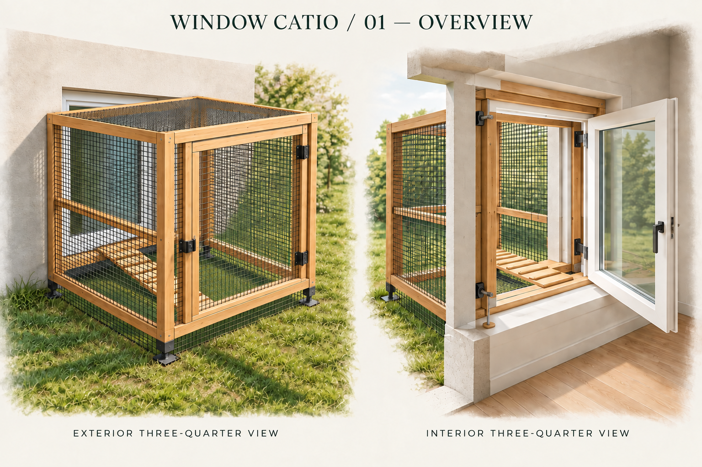](01-overview.png) |
| Front, side and top orientations | [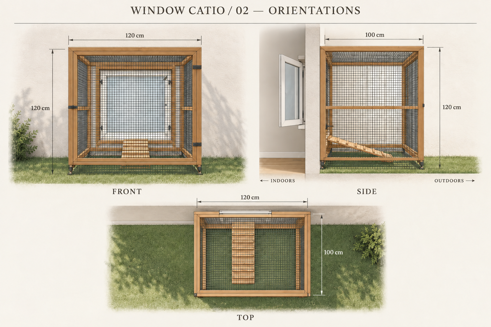](02-orientations.png) |
| Interior adjustment, exterior connection and clearance section | [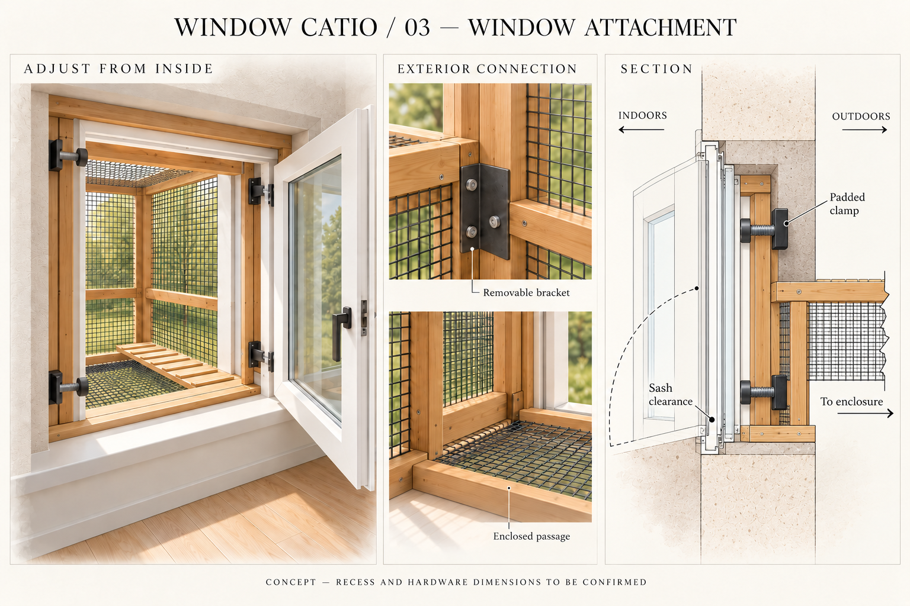](03-window-attachment.png) |
| Legs, ramp, mesh floor and grass | [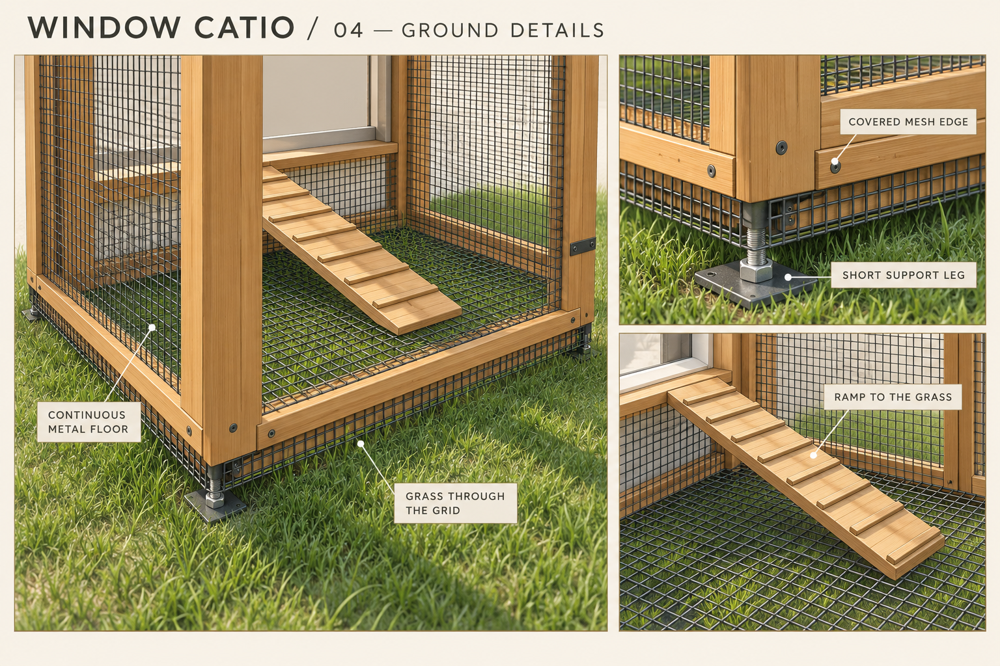](04-ground-details.png) |
| Exploded components | [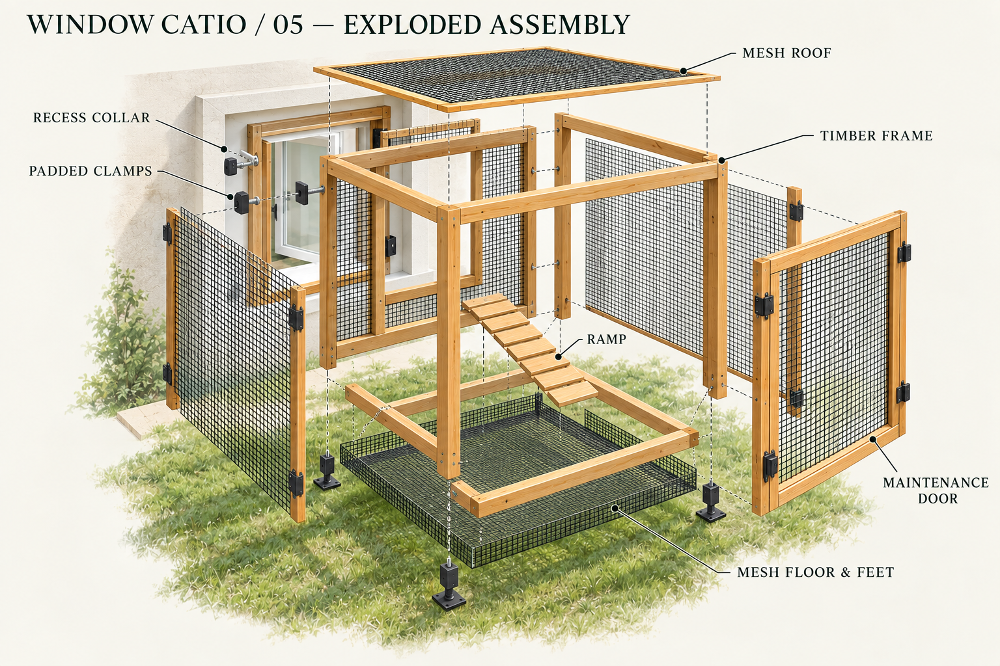](05-exploded.png) |
| Six assembly stages | [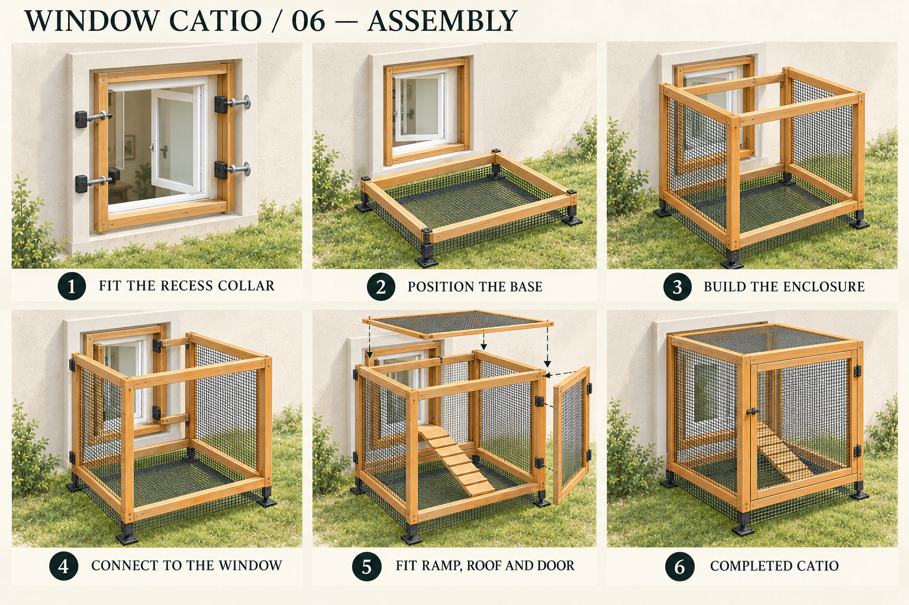](06-assembly.png) |
| Modular: exterior and interior overview | [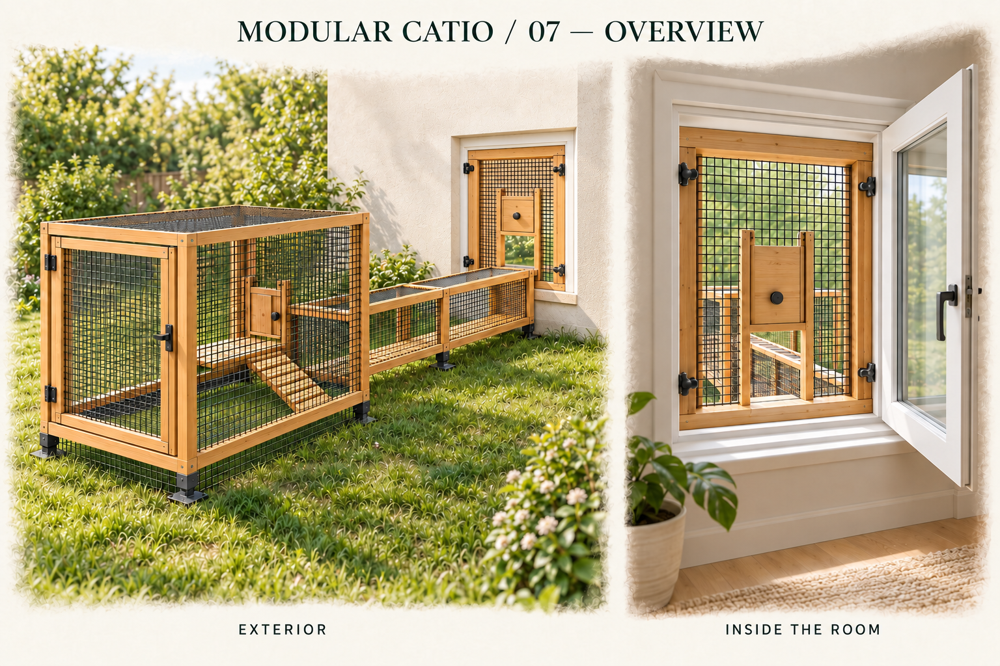](07-modular-overview.png) |
| Modular: front, side, top and three-quarter orientations | [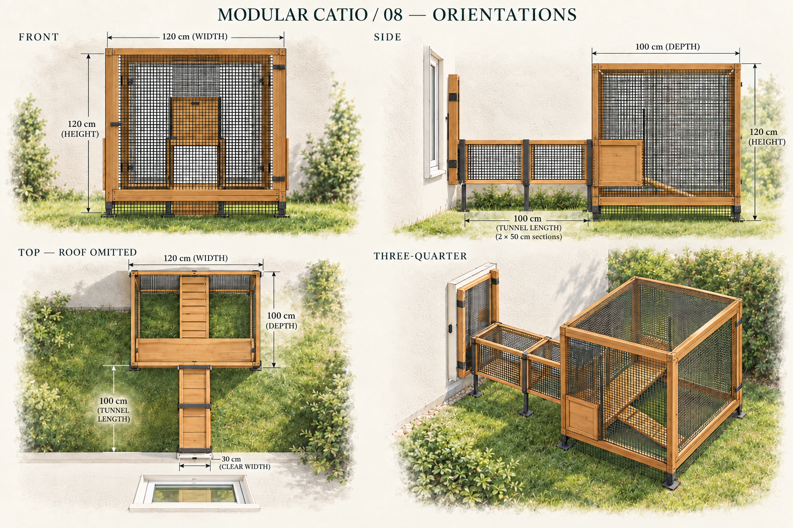](08-modular-orientations.png) |
| Modular: window adapter, gate and removable docking | [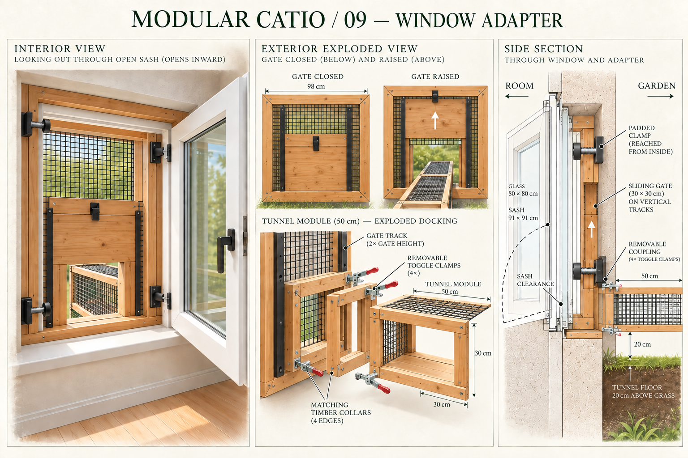](09-modular-window.png) |
| Modular: human maintenance doors and cat gates | [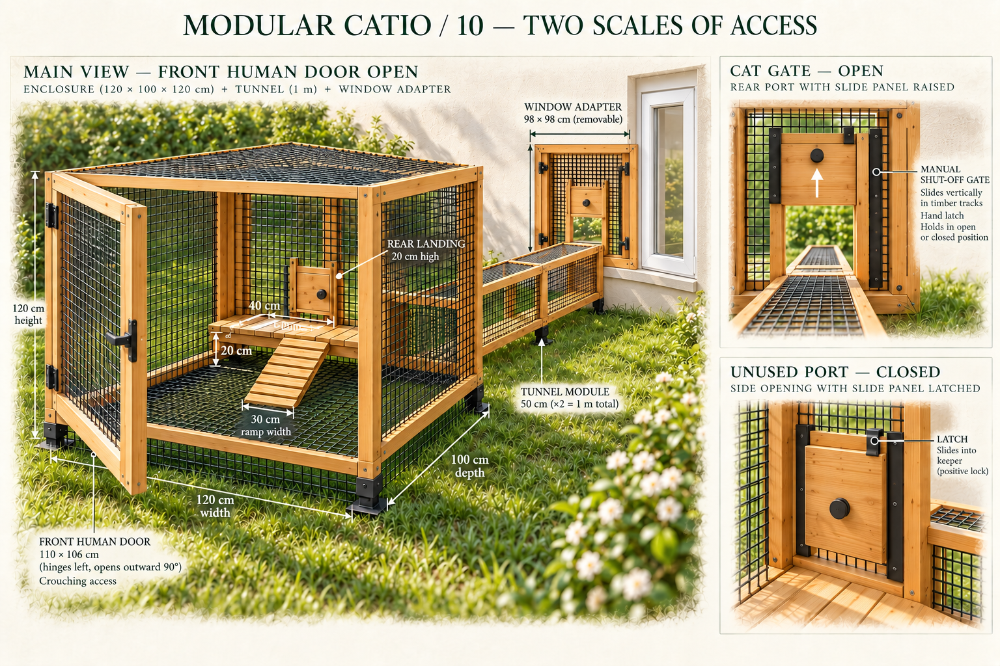](10-modular-access.png) |
| Modular: offset routes and linked enclosures | [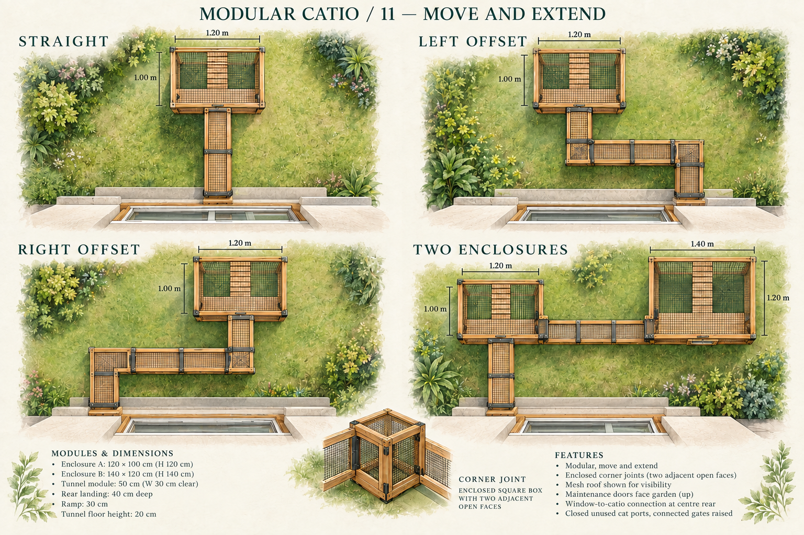](11-modular-layouts.png) |
| Modular: assembly and disconnection | [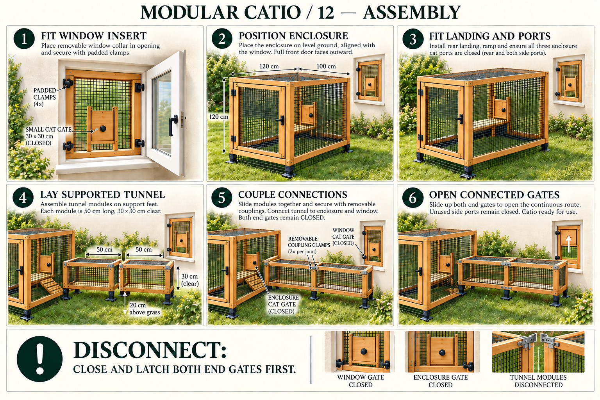](12-modular-assembly.png) |

Sheets 01–06 show the original direct design. They were created with the imagegen skill and the built-in image tool, from
inspected browser screenshots ([prompts](prompts.md)). Sheets 07–12 show the modular design ([prompts and correction
passes](modular-prompts.md)). The revised orientation and route artwork also uses inspected offline projections of the
geometry at the time: [orientations](reference/modular-orientations.png) and [layouts](reference/modular-layouts.png).

The modular sheets were drawn with sliding gates, 50 cm modules and corners of the clear width + 80 mm. A cat port is now
shut by a removable panel by default ([removable-doors.md](removable-doors.md)). A module is now one pitch, and a corner is
a module with a side port.

## Window insert

The window insert has its own live page, `#/concepts/catio/window-insert`, linked from the page heading: its pieces, parametrised timber joints, mesh fixing
and the no-drilling clamps, a staged assembly and a parts list, for both designs. See [window-insert.md](window-insert.md).

## Removable doors

Every cat port is shut by a panel that is lifted out once its turn buttons are turned clear, and the tunnel has such a panel
in its side for access; the sliding gate remains selectable. [removable-doors.md](removable-doors.md) keeps apart what the
reference product shows, what this design proposes and what is unverified, and lists the checks to make on a built door.

## Insert–tunnel coupling

The joint between the window insert's cat port and the tunnel's first flange has its own live page,
`#/concepts/catio/insert-tunnel-coupling`: a docking frame screwed to the insert, a squashed seal and a floor lip, and Ganter
GN 831 toggle latches that dock and undock the tunnel without tools. The tunnel's wall support still carries all of its
weight. See [window-insert-tunnel-coupling.md](window-insert-tunnel-coupling.md).

## Tunnel

The tunnel has its own live page, `#/concepts/catio/tunnel`.

- **Standard elements.** It is built of [standard elements](standard-port.md): every piece ends in the same square port, so
  any element couples to any other. It turns 90° at side ports (the run before coupled onto the port in the side of the next
  run's first section, whose short stub behind it is closed by a door) and runs straight on long sections, a whole number of
  pitches each. It climbs exactly on sloped sections between angle
  collars, and ends where its whole elements end.
- **Supports** stand on levelling feet for uneven ground.
- **The page** has a staged assembly, a parts list and presets (straight, 90° turn right, rising).

See [tunnel.md](tunnel.md). The planner lays its tunnels out with the same layout, in whole modules and side-port turns.

## Standard port

One port for every tunnel element, a side port at every turn, the window insert's docking frame and the enclosure. It is a square opening in a 30 × 70
ring, with its latch and bolt stations the same on all four sides. Seen from outside, it has its latches' base plates on its
left and their catch plates on its right. A port is coupled, or closed by a door set into it on turn buttons (the default)
or by a blank on its own latches.
See [standard-port.md](standard-port.md).

## Tunnel–tunnel coupling

How two of the tunnel's sections are joined has its own live page, `#/concepts/catio/tunnel-tunnel-coupling`: one section
built and laid on the support under the joint, its joint readied, then a second, identical section coming in along the
tunnel's axis and coupled to it. Printed toggle latches across a sealed 3 mm gap by default, M8 bolts through both flanges as
an option. The tunnel page couples every section and angle collar this way; mitred joints and the enclosure end stay
bolted. See [tunnel-tunnel-coupling.md](tunnel-tunnel-coupling.md).

## How the sub-assembly pages fit each other

All of them take the window's sizes and the cat ports' settings from the planner's project. The tunnel and the insert–tunnel
coupling are fitted to the window insert, and the coupling also shows the tunnel. The tunnel
follows the tunnel–tunnel coupling's mechanism at every coupling, and that page is built from the tunnel's sections, support
and feet in turn. Each page reads the others' saved settings. One declaration on the dependent page, `follows` in
[catioSubassemblies.ts](../../../apps/web/src/catioSubassemblies.ts), lists the settings of the other page that change it,
and everything else is derived from it ([CatioCrossPage.tsx](../../../apps/web/src/CatioCrossPage.tsx)):

- Both briefs link the two pages: "It fits the …" on the dependent page, and "The … are fitted to this one" on the other.
- Under every followed setting, the other page says what else it changes ("Also changes the tunnel and the insert–tunnel
  coupling.").
- When saved settings on one page break a page fitted to it, the page being edited lists that page's errors with a link.
- A page can also show and set another page's settings itself (`shares`): the owning page's saved settings hold them, the
  sharing page reads them from there when it opens and writes them back when they change, and both pages say so. The
  tunnel–tunnel coupling page shares the tunnel's **Held on the supports by** and **Supports stand** this way.
- A fact or a design decision can name the other page's settings it comes from (`from`). The page then shows "Set on the …
  page: …" under it, e.g. the coupling's cover battens and the tunnel's window port floor.

A test changes every window insert setting in turn and checks that exactly the declared ones change each dependent page; it
does the same between the tunnel and the tunnel–tunnel coupling, in both directions.

Geometry that one page owns and another shows is drawn by one builder: `buildInsertContext` (the installed insert),
`buildCouplingPieces` (the docking frame, seal, catches, latches and lip), `buildSectionPieces`, `buildSupportPieces` and
`buildCouplingJoint` (the tunnel's sections, supports and flange couplings, in
[catioTunnelPieces.ts](../../../apps/web/src/catioTunnelPieces.ts)), and `buildPrintedLatches` (the printed toggle latch, on
both coupling pages and the tunnel, placed by [catioPrintedLatch.ts](../../../packages/catio/src/catioPrintedLatch.ts)). Fasteners added on top of another page's are
placed with `clearOf` and checked with `fastenerClashes` ([catioSubassembly.ts](../../../packages/catio/src/catioSubassembly.ts)).

## Window and cat ports

The selected window's inspector in the planner sets these for the whole catio. A value out of range is kept as an issue on
the window or the enclosure, not refused, so the design stays an editable draft. The checks are `validateModular` and
`validateEnclosure` in [catioModularDesign.ts](../../../packages/catio/src/catioModularDesign.ts). "Modular" there is the
sub-assembly pages' variant with a tunnel.

| Setting | Default | Allowed values |
| --- | --- | --- |
| Glass width / height | 80 / 80 cm | 40–140 cm each |
| Sash width / height | 91 / 91 cm | 50–160 cm each; at least 3 cm border around glass |
| Cat ports' clear size | 30 cm | 20–45 cm, square (the [standard port](standard-port.md)). It is every port's size, and the tunnels are laid out again in its modules. It is subject to ramp clearance and, with sliding gates, to their travel |
| Cat-port closure | Removable panel with turn buttons | Removable panel with turn buttons; vertical sliding gate (what an imported design saved before the choice keeps) |
| Door seat | Stop strips | Stop strips inside the opening (easier to make); a rebate round it (no strip in the opening). Every door with turn buttons is set into its opening, PawHut-style |
| Each enclosure W / D / H | 200 / 200 / 200 cm in a new project | W and D 80–240 cm; H 90–220 cm. Set in the enclosure's inspector |
| Module length | One pitch: 58.3 cm | The shortest section that takes a side port (the clear size + 28 cm) and a latched coupling's 3 mm gap |
| Window and cat-port floor above grass | 20 cm | Fixed concept assumption; a port can be raised or lowered with its tunnel |
| Enclosure frame members | 40 mm | Fixed concept assumption |
| Fixed-frame allowance | 45 mm per side of sash | Fixed concept assumption |

### Connections and access

- **The window.** The cat port sits at the bottom of the removable insert, with mesh infill round it. It is shut by a
  removable panel behind turn buttons (the default) or by a sliding gate.
- **Enclosure ports.** They share the window port's clear size.
- **Tightening and coupling.** The window insert is tightened from inside. Tunnels and enclosure couplings are assembled
  outside. All installed geometry clears the inward sash sweep.
- **Tunnels.** They have solid timber floors, mesh sides and roof, and supports at section ends. Every piece ends in the
  [standard port](standard-port.md).
- **Enclosures.** Each has a continuous grass-level mesh floor, four short supports and low mesh skirts. A full-width rear
  landing meets the rear and side cat ports, and one cleated ramp descends toward the front.
- **Maintenance door.** Each enclosure has a full-front, outward-hinged maintenance door.
- **Cat-port closure.** It sets what shuts every cat port, the window's and the enclosures':
  - a panel set into the port, lifted out once its turn buttons are turned clear: solid and sealed at the window, slim framed
    mesh at the enclosures, seated as **Door seat** sets;
  - or a small manual sliding gate.

  Unused ports stay shut and retained. A sliding gate's travel (its own height again above its port) is checked only when
  sliding gates are chosen. A panel's fit, buttons and withdrawal are checked when panels are.
  [removable-doors.md](removable-doors.md) has the construction and what is unverified.

### Assembly order

1. Fit the window insert from inside; keep its cat port shut (panel seated, every turn button over it; or gate closed).
2. Position the enclosures, feet, floor skirts, walls, roof and maintenance doors.
3. Fit rear landings, ramps and what closes the rear and side ports: the removable panels, or the small sliding gates.
4. Lay straight and corner tunnel modules on their supports.
5. Couple every section and the end connections while the ports at both ends remain shut.
6. Open the connected ports after coupling (turn every button clear, lift each panel out and stow it clear of the route; or
   slide the gates up); leave unused ports and human doors shut.

Before disconnecting a tunnel, shut the ports at both of its ends: reseat the panels and turn every button back over them,
or close and latch the gates. Opening a maintenance door, or any panel on the outside, opens the catio: secure the cats
elsewhere first. Each sub-assembly page stages its own part of this. The planner's build pack (#109, later work) is to show
the whole.

## Original dimensions and assumptions

The original design's window and the insert's direct variant (`directWindow` in
[catioWindowInsert.ts](../../../packages/catio/src/catioWindowInsert.ts)) still use these fixed sizes. They live in
[catioDesign.ts](../../../packages/catio/src/catioDesign.ts).

| Item | Value | Basis |
| --- | --- | --- |
| Glass | 800 × 800 mm | User measurement |
| Movable sash | 910 × 910 mm | User measurement; excludes fixed frame |
| Sill above grass | 200 mm | Illustrative assumption; confirm on site |
| Fixed window frame | 1000 × 1000 mm | Illustrative estimate |
| Wall thickness / exterior recess depth | 300 / 150 mm | Illustrative estimates |
| Mesh | Soft cat netting, 30 mm meshes (TRIXIE 44294) | A product of the parts library; welded wire mesh (19 mm meshes of 1.45 mm wire) is the alternative |
| Net roof | Cross rails 30 × 30 under it, at most 400 mm apart | Concept default: a net sags and bags where it is not carried |
| Ramp horizontal run | 700 mm | Concept default |

The model uses millimetres, X along the wall, +Y outdoors and Z up. Grass is Z=0 and the exterior wall face is Y=0. Measured
recess size, hardware fit and structural sizing need to be established before fabrication.

## Implementation and validation

- [Window and cat-port settings and their checks](../../../packages/catio/src/catioModularDesign.ts), with
  [their tests](../../../packages/catio/src/catioModularDesign.test.ts)
- [Enclosure layout: frame, mesh, ports, landing, ramp and maintenance door](../../../packages/catio/src/catioEnclosure.ts),
  drawn with the cat ports by [their builder](../../../apps/web/src/catioEnclosureScene.ts)
- [The planner's project, commands and evaluation](../../../packages/catio/src/catioProject.ts) ([planner/](planner/README.md))
- [Shared geometry primitives](../../../apps/web/src/catioParts.ts)
- [Cat-port closures and removable doors](../../../packages/catio/src/catioDoor.ts), with
  [their tests](../../../packages/catio/src/catioDoor.test.ts) and [the scene's](../../../apps/web/src/catioDoorScene.test.ts)
- [The one-time legacy import](../../../apps/web/src/catioLegacyImport.ts), with
  [its unit tests](../../../apps/web/src/catioLegacyImport.test.ts) and
  [browser tests](../../../tests/browser/catio-legacy-import.spec.ts) for saved settings of versions 1, 2 and 3
- [Browser tests of the overview and the sub-assembly pages](../../../tests/browser/catio.spec.ts)
