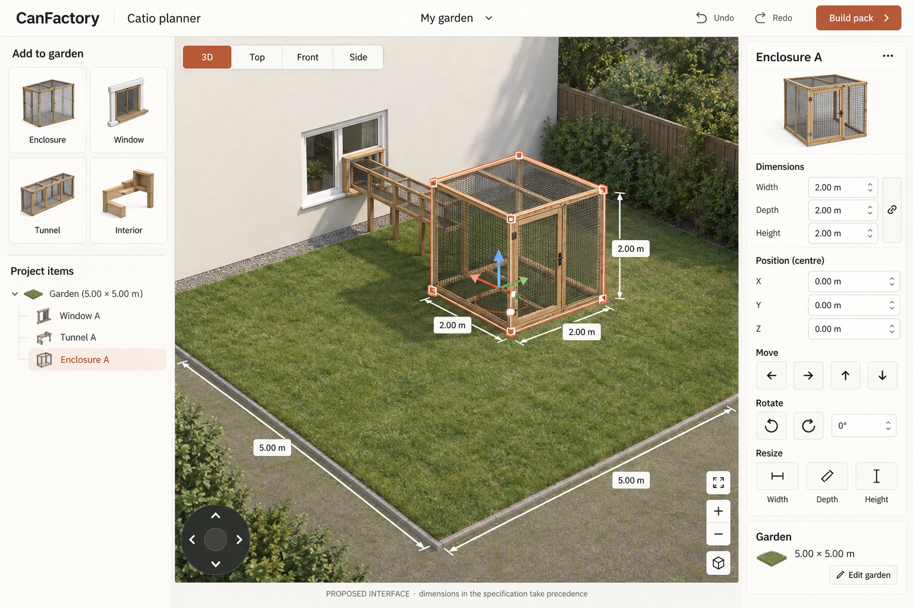
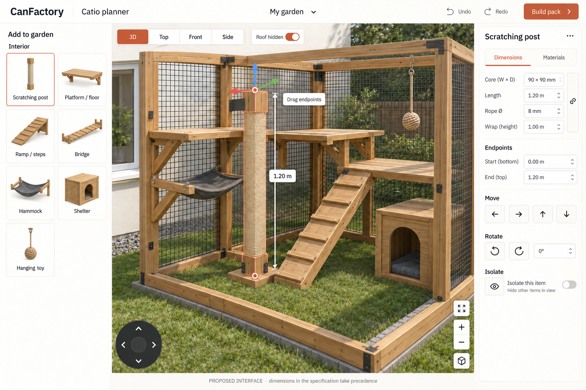
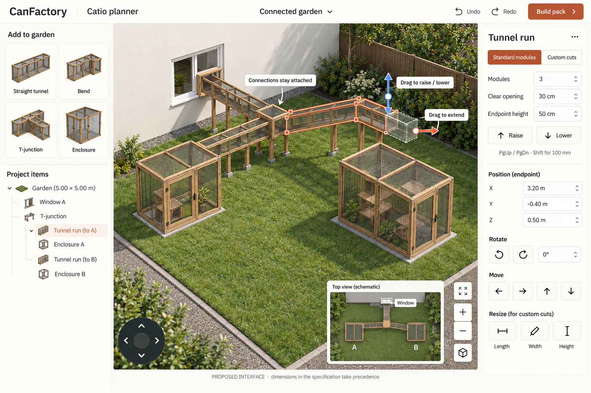
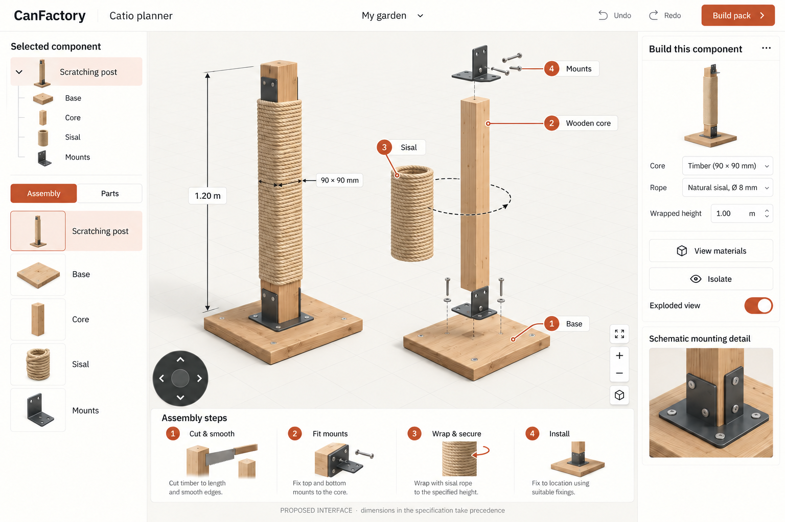
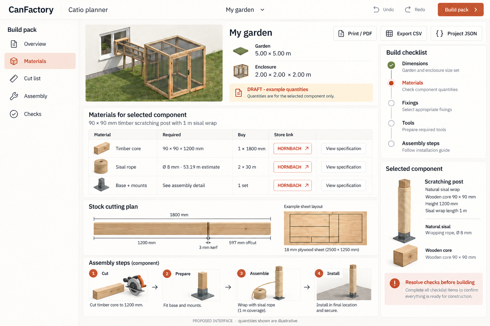

# Catio planner specification and design studies

This directory contains the requirements and original interface studies for an in-browser catio planner.

- [Full issue specification](issue.md): agreed scope, numbered requirements, user stories and acceptance criteria.
- [Product research and construction-recipe matrix](products.md): sourced German products, generic hardware-store specifications and quantity examples.
- [Image prompts and provenance](prompts.md): exact prompts, correction passes and artifact mapping.

## Gallery

| Study | Image |
| --- | --- |
| 01 · Garden and enclosure |  |
| 02 · Interior customization |  |
| 03 · Tunnel extension and elevation |  |
| 04 · Isolated component and assembly |  |
| 05 · Build pack |  |

These are proposed interfaces, not implemented screenshots or manufacturing drawings. Numeric fields, hardware and perspective in generated images are schematic; the written requirements and evaluated project geometry govern the implementation. Study 03 shows a branch in progress with a free end/extension preview, not a completed connection to the second enclosure.

All five images were generated with the built-in image tool using the imagegen skill workflow, then inspected. Study 02 was corrected to show a supported post; study 04 was corrected to retain a continuous wooden core; study 05 was corrected to remove unsupported material claims and show the researched stock sizes. The first image supplies the style reference for the other views.

The documentation is published separately from application implementation. The GitHub issue uses immutable commit URLs for these assets so subsequent branch changes do not alter its embedded design references.

## Implementation status

Built on `feat/catio-planner` (umbrella PR #111, tracking issue #109). Each PR edits only its own row.

| Issue | Phase | Scope | Status |
| --- | --- | --- | --- |
| #112 | PoC 1/4 | Move the pure catio domain into `@canfactory/catio`, with explicit inputs | In review: `packages/catio`, `enclosureLayout` |
| #113 | PoC 2/4 | Project document, commands, undo/redo, `evaluate()`, one platform | In review: `catioProject*.ts`, `catioPlatform.ts` in `@canfactory/catio` |
| #114 | PoC 3/4 | Planner page, scene and direct manipulation | In progress: `CatioPlanner.tsx`, `catioPlanner*.ts`; shared store `catioPlannerStore.ts` |
| #115 | PoC 4/4 | Local persistence, JSON import/export, draft build list | Open |
| #116 | Full scope | Replace the Direct and Modular concept page; no legacy code | Open |
| #117 | Full scope | One settings source: sub-assembly pages read and write the project | Open |
