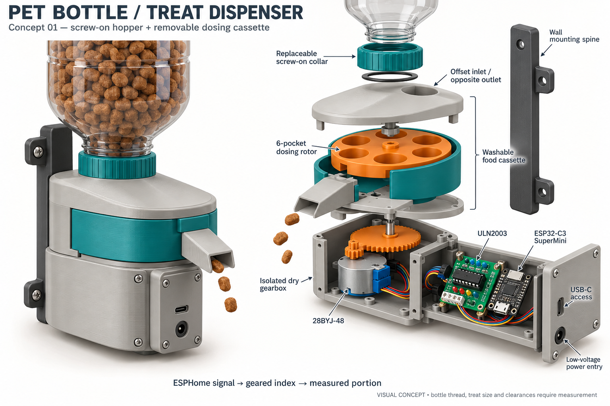
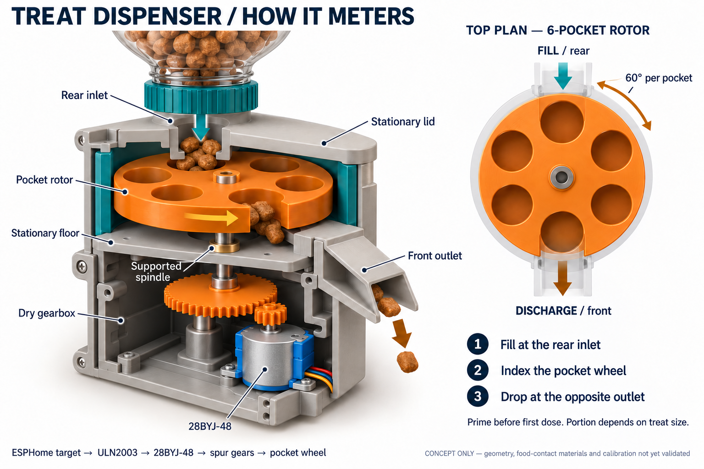

# PET-bottle treat dispenser — visual concept

Design review images for an inverted PET-bottle hopper, a geared portioning mechanism, and a housing for the three existing library parts. **Images only: no printable CAD/STL, firmware, or verified assembly is supplied in this concept.**

## 01 — Assembly and electronics

## 02 — Dispensing mechanism

Open either image for the full-resolution 1536 × 1024 sheet. The wall bracket supports the assembly and inverted bottle; the device is not intended to balance on its neck.

## Proposed construction

- **Replaceable screw-on bottle collar:** female thread and gasket seat in the inlet lid. Match the thread to the actual bottle and prototype a short fit-test ring first; “common PET bottle” is not a confirmed neck specification or a universal fit.
- **Removable food cassette:** stationary inlet lid, six-pocket horizontal rotor, stationary floor and enclosed discharge chute. Remove the bottle before opening the cassette. The food-contact pieces come apart independently of the electronics for cleaning; washability and materials still need validation.
- **Separate fill and discharge:** the bottle fills a pocket at the rear. The floor supports that pocket while it travels; the opposite front opening releases the portion into the chute. The lid above the discharge is closed, and the floor below the inlet is closed, so there is no intended straight-through gravity path. Open edges in the section illustration are cutaways, not operating openings.
- **Dry drive below the floor:** an upright 28BYJ-48 drives a small spur pinion, a larger gear and an independently supported rotor spindle. The spindle passes through a fitted bushing in the bulkhead. The chute bypasses the gearbox. The intended torque path is clearest in sheet 02; tooth geometry, bearings, seals and shaft coupling are schematic, not dimensioned.
- **Separate electronics pod:** ULN2003 on insulated standoffs and the smaller ESP32-C3 SuperMini in an edge carrier, with removable screw-fixed cover, USB-C access, button access under the cover, connector/wire clearance and a separate low-voltage power entry. Keep the antenna end away from metal and the motor. No wiring/pin assignment is specified by the artwork.

### Existing part-library basis

| Part | Library ID | Reference envelope used to guide the concept |
| --- | --- | --- |
| 28BYJ-48, 5 V | `kiatronics-28byj-48-5v` | Ø28 × 19 mm can; mounting holes 35 mm apart; Ø5 mm shaft with flats, offset 8 mm from the body axis |
| ULN2003 driver | `uln2003-stepper-driver-board` | 35.3 × 31.4 mm PCB; allow additional height for plug, headers, wires and underside leads |
| ESP32-C3 SuperMini | `nologo-esp32-c3-supermini` | 22.52 × 18 mm PCB; allow USB-C overhang, connector insertion and button access |

These values come from the repository's [motor](../../../packages/contracts/src/parts/stepper-motors.ts), [driver](../../../packages/contracts/src/parts/stepper-drivers.ts) and [board](../../../packages/contracts/src/parts/dev-boards.ts) definitions, including their measurement/variant caveats. Rendered component details and proportions are approximate, not fit-check geometry. Measure the actual hardware before modeling mounting pockets, especially the motor's offset shaft and the driver-board hole positions.

## Rotation and ESPHome intent

One pocket pitch is **60° at the rotor**, not necessarily 60° at the motor. A proposed 3:1 external spur reduction would require 180° of motor output-shaft rotation for that pitch; final tooth counts and calibrated steps are not specified by the illustration. The motor already has its own internal gearbox. Its exact steps per output revolution should not be inferred from a nominal 64:1 ratio.

A filled rear pocket reaches the opposite outlet after three pocket pitches (180° of rotor rotation). A newly loaded empty cassette therefore needs priming before normal one-pitch dispensing; do this over a catch container. Once primed, successive pitches present successive pockets to the outlet. Pocket volume is a portion, **not a guaranteed single treat**; irregular treats may leave pockets empty or bridge the inlet.

The intended control chain is an ESPHome trigger → a calibrated relative move → stop. ESPHome provides the ULN2003 platform and `stepper.set_target` in its [official stepper documentation](https://esphome.io/components/stepper/index.html). Firmware, restart position recovery, homing and jam detection are outside this image-only proposal. Use bounded movement and explicit manual re-priming/re-indexing after a restart until a recovery scheme is designed; software position alone does not establish actual rotor position.

## Decisions before printable CAD

1. Measure the bottle thread/profile, neck opening and shoulder clearance. Confirm that the largest treats can pass the neck without bridging; otherwise this bottle hopper is unsuitable.
2. Measure the treat size range and choose portion volume, pocket diameter/depth, inlet taper and outlet size. Test the shear edge and clearances with actual treats; consider a compliant wiper and low-force coupling instead of a rigid crushing edge.
3. Finalize gear ratio/module, backlash, shaft bearings, bulkhead dust exclusion, cassette latch and service clearances. Demonstrate that crumbs cannot reach gears or electronics.
4. Test fit coupons for all three hardware variants, plug clearance and motor cradle alignment. Plan the low-voltage supply for the actual 5 V motor/boards; the image is not an electrical schematic.
5. Validate contact materials, cleanability, bracket strength with a full bottle, accessible pinch points, jams and repeatable dosing. Printed surfaces are not automatically food-safe or hygienic. Do not treat this untested concept as a validated unattended feeder.

## Image provenance

Generated using the imagegen skill's **built-in `image_gen` tool**, opaque background; no CLI fallback. Final prompts are preserved in [overview-prompt.txt](overview-prompt.txt) and [mechanism-prompt.txt](mechanism-prompt.txt). Sheet 02 used sheet 01 as a style/product reference, then received the targeted [motor-location correction](mechanism-correction-prompt.txt). Only the selected final images are committed. These illustrations communicate design intent; this written mechanism description takes precedence over generated small-detail inconsistencies.
