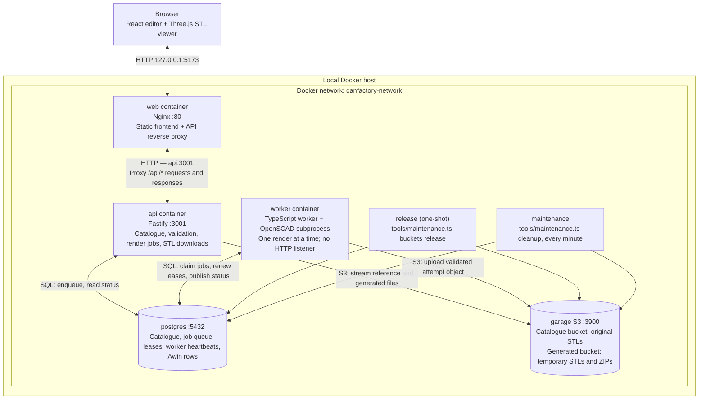
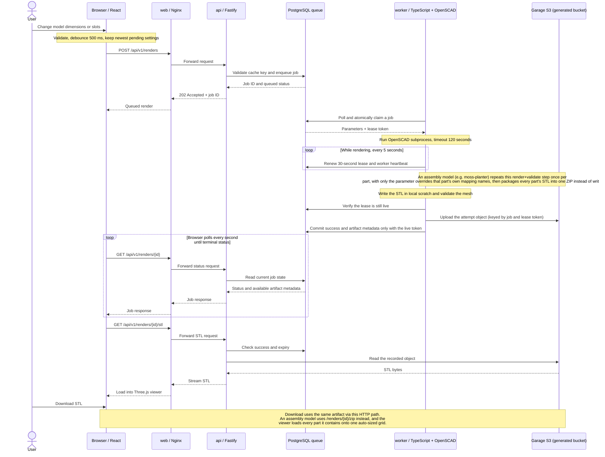
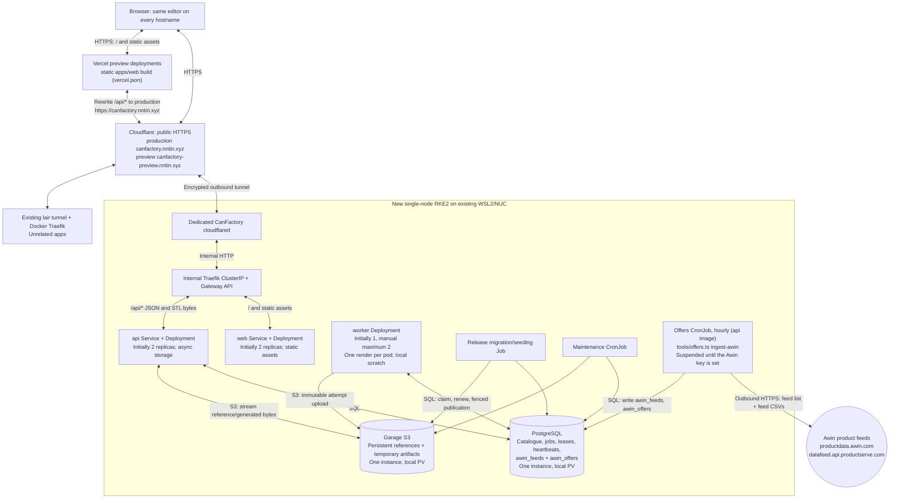
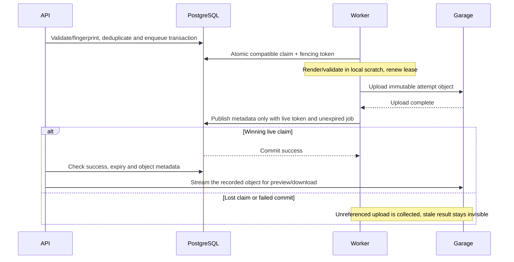

# Containers and communication

Production moved to Kubernetes on 2026-09-22 after explicit cutover approval.
The Kubernetes diagrams below describe the live production and preview endpoints.
The first two diagrams show Docker Compose, which now serves local development
and CI only; service names and ports match [compose.yaml](../compose.yaml). It
runs the same storage as Kubernetes (PostgreSQL and Garage S3). The former
SQLite Compose deployment was deleted, and with it the Compose rollback path
(#90).

## Local Docker Compose (development and CI)

React and Three.js run in the browser; the web container serves their static
build. Only `web` publishes a host port. `api`, `postgres` and `garage` listen
inside the Docker network, and `worker` has no listening port. OpenSCAD runs
inside the worker container, in local scratch under `/tmp`.

The API and worker communicate through PostgreSQL and Garage, as in Kubernetes.
There is no API-to-worker HTTP call or message broker. Trusted model definitions
and SCAD sources are packaged in their images. The API, worker, release and
maintenance containers share one set of local-only credentials from
`compose.yaml`.

| Connection | Purpose | Current protocol or access |
| --- | --- | --- |
| Browser ↔ web | Editor/API/STL access | HTTP on localhost port 5173 (configurable with `WEB_PORT`) |
| web ↔ api | Forward every `/api/*` request and its response | HTTP to Docker service DNS `api:3001` |
| api ↔ postgres | Catalogue, cached results, queued jobs, offers | PostgreSQL protocol to `postgres:5432` |
| worker ↔ postgres | Claim jobs, heartbeat, renew leases, record completion/failure | PostgreSQL protocol to `postgres:5432` |
| api → garage | Stream original and generated STL/ZIP bytes | S3 HTTP to `garage:3900` |
| worker → garage | Upload a validated attempt object before publishing it | S3 HTTP to `garage:3900` |
| release → postgres, garage | Create buckets, migrate, seed the catalogue and references, once per `up` | PostgreSQL and S3 |
| maintenance → postgres, garage | Recover leases, delete expired jobs and objects, every minute | PostgreSQL and S3 |

Compose starts `api` and `maintenance` after `release` completes, and `web` and
`worker` after the API health check passes. These are startup dependencies, not
other communication channels. Nginx refreshes Docker DNS so API address changes
do not require a web restart.

## Render request and STL delivery

This sequence shows a cache miss. A matching unexpired successful render returns
immediately from the API without another OpenSCAD run.

Status polling overlaps rendering; it is drawn afterward to keep the sequence
readable. Failed renders return a terminal error without an artifact. Abandoned
leases allow one retry, while fencing tokens prevent stale workers from
publishing. The API refuses expired jobs/files; maintenance removes them.

## Live Kubernetes deployment — production and preview

The user selected one WSL2/NUC host, RKE2, Flux, an application Helm chart,
PostgreSQL-backed jobs, local Garage, a dedicated tunnel, and independent manual
web/API/worker scaling. Short interruption and discarding old temporary renders
are acceptable. Detailed behavior is in the implemented [tech plan](kubernetes-tech-plan.md).

Production (`canfactory.nntin.xyz`) follows `develop`'s chart releases, and the
preview (`canfactory-preview.nntin.xyz`) follows the newest pull-request chart;
`npm run preview:check` (`tools/check-preview.ts`) reports which commit each
serves. Both hostnames reach the cluster through the same tunnel. Vercel preview
deployments are separate: `vercel.json` builds only `apps/web` and rewrites
`/api/:path*` to production, so a Vercel preview calls the production API,
queue and storage.

The offers CronJob (`charts/canfactory/templates/offers.yaml`) runs
`node --import tsx tools/offers.ts ingest-awin` in the api image. It downloads
Awin's feed list and the curated offers' feeds over HTTPS and writes the
`awin_feeds` and `awin_offers` tables, which `GET /api/v1/offers` reads. It is
suspended until the `offers.secret` Secret holds `AWIN_DATAFEED_KEY` and the
network policy allows egress to both Awin hosts on 443. See
[affiliate-offers.md](affiliate-offers.md).

Preview and download still pass through the API and reference the same immutable
artifact. API reads enforce expiry regardless of object cleanup timing. There is
no worker HTTP Service or API-to-worker RPC. PostgreSQL is also the job queue;
no broker is introduced. Generated settings/files expire after one hour and
catalogue reference objects persist.

Both data services use network APIs even though their local volumes reside on
one node. Replicating application pods does not replicate these volumes or provide
availability after losing the NUC. Local copies support rollback; machine-loss
recovery rebuilds from Git/images and reseeds references with an empty render queue.

## Publication and failure boundaries

There is no atomic transaction spanning PostgreSQL and Garage. The adapter must
handle upload/commit failures, durable deletion retries and abandoned uploads.
API processes no longer own migrations, seeding or cleanup. Release Jobs serialize
schema/catalogue changes; maintenance is independently coordinated. Fingerprint-
changing releases pause submissions and drain old work before catalogue activation.

Resource budgets, HTTP draining, lease recovery, immutable publication, expiry and
rolling upgrades have passed real multi-replica tests. The infrastructure repository
records exact evidence and remaining limits in `docs/canfactory/validation.md`.
Production cutover was separately authorized and executed. Browser customization,
inspection and downloads passed on the production hostname after routing converged.
Shared Compose infrastructure remains operational for unrelated applications. The
legacy SQLite CanFactory deployment is no longer a rollback target: its storage
backend was deleted (#90), so a rollback means an earlier chart release. See the
infrastructure validation record for one-hour observation results and remaining
recovery limits.
