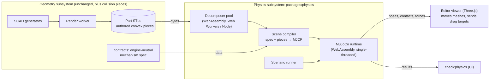

# Physics plan

How CanFactory simulates the motion of printed assemblies: joints, springs, gravity, contact (collision), gear teeth, and approximate permanent-magnet dipoles.
It serves two goals with one engine:

- **CI tests.** `npm run check:physics` runs scripted scenarios on the rendered parts and checks their outcomes within
  tolerances, as `check:assembly` checks collisions.
- **Interactive use.** The editor's viewer gets an interactive mode in which the user drags the assembled parts freely and
  sees them move under gravity, springs, joints and contact.

This file is the plan agreed in issue can-48 (planning, 2026-10-09). The [status](#status) section at the end records what is
done. Read it again before continuing the work.

## Decisions

| Topic | Decision |
| --- | --- |
| Separation | Geometry generation and physics simulation are separate subsystems. Physics is the package `packages/physics`, running in its own browser Web Worker (interactive) or its own Node process (CI). No Kubernetes service is added. |
| Engine | [MuJoCo](https://mujoco.org), through its official WebAssembly build (`@mujoco/mujoco`, pinned to an exact version). The same `.wasm` runs in the browser and in Node, so CI tests what users get. |
| Threading | Single-threaded build. Revisit only if the frame rate demands it: the multithreaded build (`@mujoco/mujoco/mt`) needs `SharedArrayBuffer`, so the site would have to send COOP/COEP headers (Cloudflare, Traefik, and every cross-origin resource). A comment where the engine is loaded says so. |
| Model description | Generated MJCF XML. `mjSpec`'s web bindings are still marked untested. |
| Interaction | Free dragging: the viewer raycasts the picked part and sends a target; the worker applies MuJoCo's spring-damper perturbation (`MjvPerturb`), as MuJoCo's own viewer does. |
| When it builds | Only when the interactive mode is opened (and for each CI scenario). A parameter change while it is open makes the physics stale until it is rebuilt. |
| Joints | Ideal joints (hinge, slide, ball, fixed) by default. A joint may opt into **contact**: then the part's real pin and hole collide, with their clearance. |
| Collision geometry | In order of preference: (1) parts-library hardware as exact primitives from its dimensions; (2) convex pieces that the geometry side outputs (each gear tooth, cut at its root circle, and the hub); (3) convex decomposition of the part's STL, in the browser and in CI. |
| Decomposer | Both [V-HACD 4](https://github.com/kmammou/v-hacd) and [CoACD](https://github.com/SarahWeiii/CoACD) were compiled to WebAssembly and measured (spike 2); **V-HACD** is kept. |
| Gears | No gear constraint. Gears are hinges, coupled by the contact of their teeth. Tooth contact is required. |
| Materials | Per-material data (density, friction) is enough; print orientation is not modelled. Values come from cited primary sources. |
| Mobile | Nice to have and strongly encouraged; desktop first. |

## Why MuJoCo

The options compared in can-48 were Rapier, Jolt, PhysX (WebAssembly ports), Ammo.js, cannon-es, MuJoCo, Project Chrono,
Drake, Pinocchio and ODE. The interactive goal needs a browser build, which rules out Chrono, Drake, Pinocchio and ODE (and
streaming a server simulation at 60 Hz is a poor fit for the API/worker design). Of the WebAssembly engines, MuJoCo has
soft, tunable contact (stable at sub-millimetre clearances), built-in perturbation for dragging, first-party Node and browser
builds of the same code, and an Apache-2.0 licence. Its risks: the JavaScript bindings are marked work in progress, and it
collides meshes only as convex hulls (hence the decomposition).

## Architecture

- **Contracts** gain only engine-neutral data: the mechanism spec. Nothing in contracts knows MuJoCo.
- **`packages/physics`** depends on contracts (for the spec's types) but never on SCAD, OpenSCAD or the render pipeline. Its
  inputs are the spec and mesh bytes; its outputs are poses, contacts and forces.
- **The viewer** stays a viewer: in the interactive mode it shows the poses the worker posts each frame and forwards picks and
  drag targets. The physics runs in a dedicated Web Worker, never on the page's main thread.
- **CI** renders the parts as `check:assembly` does, then runs `packages/physics` in Node.

## Mechanism spec (contracts)

Implemented as `packages/contracts/src/physics.ts`; a model provides it as `ModelDefinition.physics(parameters)`.

A model's assembly may carry a `physics` section (engine-neutral; units mm, g, s, N, degrees):

- **bodies**: one per part or reference object (by its id in the assembly's poses), its **material** (density from
  `materials`), whether it is **fixed** (welded to the world), and optional overrides (mass, centre of mass).
- **joints**: between a body and its parent (or the world), each with a type (`hinge`, `slide`, `ball`, `free`, `weld`), an
  anchor and axis in the assembled frame, optional range, stiffness with a rest position (a spring), damping and dry friction
  (`frictionloss`, e.g. a snap's retention), and a **model**: `ideal` (default) or `contact`.
- **springs** from the parts library: a compression spring between two bodies takes its rate and lengths from the library entry.
- **collision**: per body, where its collision shape comes from: `primitive` (library hardware), `pieces` (authored convex
  pieces from the geometry side), or `decompose` (default), plus contact exclusions (pairs that never collide, e.g. bodies joined
  by an ideal joint).
- **scenarios**: named CI checks: initial poses, gravity direction, scripted drives (move a body or turn a joint along a
  timeline), duration, and assertions (a body's position, angle or contact state within a tolerance at a given time).

The spec is TypeBox, like the rest of contracts, and validated by tests that compare it with the SCAD files where values come
from them (as `toggleLatchMechanism.ts` does).

Materials (`PHYSICS_MATERIALS`) carry each value's source and what was read there. No published figure was found for printed
plastic sliding on printed plastic; the nearest is printed PETG and PLA sliding on acrylic (0.28–0.30, natural surfaces), which
is used for both. Printed parts are taken as solid; a body whose real mass is known (the lighter, 13 g) gives it.

## Collision geometry

1. **Primitives.** Balls, pins, screws, magnets and other parts-library hardware become MuJoCo spheres, cylinders, capsules
   and boxes from their dimensions. The detent's ball is an exact sphere.

   **Library hardware** (#92). These primitives are not a third drawing of the part. `primitive()` in
   `packages/physics/src/build.ts` only turns a mechanism spec's `collision` (`sphere`, `box` or `cylinder`, with its size and
   centre) into a MuJoCo geom; it knows no family and draws no head, thread or pitch. The size is written in the mechanism's
   spec in contracts, next to the model, from the part's dimension (the detent's ball from its `d`). A body's mass and inertia
   still come from its closed mesh: for a reference object that is the mesh `@canfactory/part-geometry` draws, the same one the
   parts library, the editor and `npm run check:assembly` use (`tools/assembly-meshes.ts`). An analytic sphere also collides
   exactly where a faceted mesh would make a rolling ball bump, so the primitives stay.
2. **Authored pieces.** A part may output its own convex pieces: the geometry side renders a collision variant of the part (a
   SCAD define) in which every piece is its own solid, and physics uses them instead of decomposing. Gears output each tooth,
   cut at the root circle, and the hub. Physics checks each piece is convex (its hull's volume matches its own). The transport
   format (one file per piece, OpenSCAD's lazy-union 3MF, or slightly separated solids split into connected components) is
   settled in spike 4. The pieces are requested through the existing render queue when the interactive mode opens, so
   producing them stays the geometry subsystem's job.
3. **Decomposition.** Everything else is decomposed into convex pieces by the chosen decomposer, compiled to WebAssembly, with a
   fixed seed so that the browser and CI get the same pieces. Each part decomposes in its own Web Worker (no shared memory
   needed). Results are cached in the browser (IndexedDB) by STL hash, decomposer settings and decomposer version; the cache is
   only a speed-up.

## Units and scale

MuJoCo has no units. The scene compiler converts the spec's millimetres to **metres** and grams to **kilograms**, so that
gravity is 9.81 and forces are in newtons. Clearances of 0.1 mm become 1e-4 m, so the time step, contact margin and soft
contact parameters (`solref`, `solimp`) are tuned for that scale.

Spike 1 measured how far small parts sink into a floor at rest (`DEFAULT_OPTIONS` in `packages/physics/src/scene.ts`):

| Time step | `solref` | `solimp` | 10 g box, 20 mm | 4.5 mm steel ball | Cost per simulated second |
| --- | --- | --- | --- | --- | --- |
| 2 ms (MuJoCo's default) | 0.02 1 | 0.9 0.95 0.001 | 108 µm | 367 µm | 43 ms |
| 0.5 ms | 0.002 1 | 0.9 0.95 0.001 | 1.1 µm | 4.4 µm | 51 ms |
| **0.5 ms (chosen)** | **0.002 1** | **0.99 0.999 0.0001** | **0.10 µm** | **0.40 µm** | **31 ms** |
| 0.2 ms | 0.001 1 | 0.99 0.999 0.0001 | 0.02 µm | 0.10 µm | 81 ms |

MuJoCo's defaults let parts sink as far as the models' clearances, so they cannot be used. The chosen row keeps contact well
under a micron and still runs about 30 times faster than real time on this host (Node, single-threaded).

## Quasi-static

The engine's contacts are soft: a part striking another is stopped over about its speed times the contact time constant (2 ms).
A 0.4 g steel ball let go 0.8 mm into its 4.6 N/mm spring reaches about 3 m/s and passed millimetres into, and through, the
printed lip. So the physics is quasi-static: printed mechanisms are judged at rest and in slow motion.

- A sprung joint is damped to a 50 ms time constant (`QUASI_STATIC` in contracts: damping = stiffness × 0.05). Only joints whose
  scenarios strike something fast are damped: the toggle latch's hinges and slide are not, since damped they made its lever creep
  back under gravity, which looked nothing like a real latch; its scenarios drive the lever and pull the catch, and still pass.
- The physics side adds inertia (MuJoCo's armature) to every sprung or damped joint (`jointArmature` in build.ts): at least 10 Δt c,
  because MuJoCo integrates joint damping implicitly and that dilutes the contact forces on a light body by its mass over its mass
  plus Δt c (the damped ball crept through its lip without it); and at least k (Δt / 0.2)², so that a spring's oscillation takes
  30 steps or more.

Neither changes anything at rest, which is what the scenarios check; both slow the motion. Setting a joint's position before each
step does not hold it either (the spring moves it within the step): joint drives are constraints (below).

## Determinism

The same pinned `.wasm` runs in Node and the browser, single-threaded. A test runs a reference scene in Node
(`referenceScene.ts`: a mesh cube, a steel ball, a sprung hinge and a slide with dry friction) and compares a hash of the state
after 2000 steps with a recorded value. CI assertions use tolerances rather than exact values, so a later
engine upgrade only needs the recorded hash renewed, not every scenario.

## Test cases

| Case | Bodies and joints | What CI checks |
| --- | --- | --- |
| Cigarette case: lighter in the round bay | Case box fixed; lighter free; holder on a slide with dry friction for its snap | Upright, the lighter comes to rest on the tab and the holder stays. Upside down, pushing the lighter in pushes the holder out through the floor (about 5.2 mm, see [cigarette-case-assembly.md](cigarette-case-assembly.md#upside-down-the-push-out)). |
| Spring-ball detent | Body fixed; ball (sphere) on a slide, with the library spring's rate and installed length | The ball rests on the lip with the installed preload; pushed in by the travel, the force matches the spring's rate. |
| Toggle latch | Base fixed; lever, link and catch on ideal hinges and a slide from `toggleLatchMechanism.ts`; optional contact pins | Driving the lever reproduces `TOGGLE_LATCH_HOOKED` within tolerance; closed and pulled, the lever stays closed (over centre). |
| Gears (later) | Hinges on the axes; authored tooth pieces | Turning one gear turns the other at the tooth ratio; backlash matches the geometry. |

## Engine notes

- `@mujoco/mujoco` is pinned to 3.14.0. Its typings return `any` for arrays, so `packages/physics/src/engine.ts` narrows the part
  of the API the package uses; nothing else touches the bindings.
- Reading `MjData.eq_active` throws a binding error in 3.14.0, so equality constraints cannot be switched on and off at run time.
  Dragging therefore applies a spring force (`xfrc_applied`) instead of a mocap body on a switchable constraint, the same way as
  MuJoCo's own `mjv_applyPerturbForce`, with the point's velocity from `mj_objectVelocity`.
- A scenario's push is a fingertip: a 1 mm sphere on a mocap body, moved along the timeline and taken away when it lets go. A
  spring on the pushed point, scaled to the body's mass like the pointer's drag, was far too weak for a 0.4 g ball on a 12 N
  spring, and an explicit spring stiff enough would be unstable.
- Joint drives (scenarios) are joint equality constraints whose target the simulation moves (`eq_data`), with a 1 ms time
  constant and impedance 0.9999: MuJoCo scales a constraint's stiffness by the body's mass, so a light part on a stiff spring
  pulls a softer one off its target (a 0.4 g ball on 2 N/mm gave way 0.09 mm). Setting the joint's position before each step
  does not hold it: the spring moves it within the step.
- The integrator is `implicitfast`, so that joint springs and damping are integrated implicitly.
- Whether two bodies touch is measured with `mj_geomDistance` (within 10 µm), not from the contact list, which only holds pairs
  that already overlap. A contact margin and gap would report near pairs too, but they changed where parts rest by 20 µm.
- Dry joint friction (`frictionloss`) is a soft constraint as well: with MuJoCo's defaults a holder held by 2 N crept down
  under its own 0.02 N weight at 10 mm/s. Its `solreffriction` is the contacts' and its `solimpfriction` 0.9999, which stops it.
- `DoubleBuffer` is constructed with its size (`new DoubleBuffer(n)`), not with an array as the package's README shows.

## Test case results

`npm run check:physics` (all with given pieces; see below why):

| Model | Scenario | Result |
| --- | --- | --- |
| Spring-ball detent | Rests on the lip | 6 µm under the lip, touching it |
| | Upside down | still on the lip |
| | Pushed in by the travel | the spring pushes back 16.400 N (layout: 16.4 N) |
| | Pushed in flush, let go | back on the lip |
| Toggle latch | Closed, pulled with 10 N | lever and catch stay put (over-centre lock) |
| | Lever turned to dead centre against the pull | catch drawn in 0.322 mm (table: 0.32) |
| | Lever opened to 60° | catch let go 1.249 mm (table: 1.25) |
| Cigarette case | Upright | the lighter rests on the tab, 2.4 mm clear of the holder |
| | Turned over about X (wheel side to the tab) | its hood pushes the holder out about 5.5 mm until its lever lands on the tab (documented: 5.2 mm; the hood is solid between its thumb rings here and the lighter settles 0.25 mm sideways, so the window is ±0.5 mm) |
| | Turned over about Y (front end to the tab) | it lands on the tab; the holder stays |
| | Case upside down | the holder's and the lid's fits keep them on; the lighter falls 1.1 mm onto the lid's ceiling |
| | Lid closed, the lighter pulled up | it stops at the lid's ceiling, 1.1 mm up; the lid stays |
| | Lid slid off, the lighter pulled up | it comes out |

The holder's fit and the lid's are assumptions (2 N, `HOLDER_HOLD`; 1.5 N, `LID_HOLD`): how firmly a printed friction fit holds
is not known without printing. The lid slides up the box on an ideal joint, carrying the mini box and mini lid (welded to it); its
ceiling over the bay is its collision piece. Its hold lies between the editor's pull on the lighter (1.3 N) and on the lid (2.4 N),
so the lid can be pulled off but the lighter cannot force it.
Each mechanism lives next to its geometry in contracts: `springBallDetentPhysics` (models.ts), `toggleLatchPhysics`
(toggleLatchMechanism.ts) and `cigaretteCasePhysics` (cigaretteCasePhysics.ts, whose SCAD values a test keeps equal).

## Spike 4: gears

No catalogue model has gears yet, so the spike uses a fixture: `spurGear.ts` in contracts draws an involute spur gear (ISO 53 basic
rack, 20°) and gives its pieces tooth by tooth, each tooth cut at the root circle and extruded (an external involute tooth is
convex), plus the hub; `tools/physics/fixtures/spur-gear.scad` draws the same gear with the same formulas. Transport format: the
pieces are computed on the geometry side from the same values as the SCAD file, as the other models' given pieces are, and
`check:physics` renders the SCAD gear and checks that no piece reaches out of it (both gears: under 1 µm).

The pair (m 1.5, z 20 and z 40, each tooth thinned 0.05 mm) is coupled only by its teeth:

| Scenario | Result | Geometry |
| --- | --- | --- |
| The driver turned 90° | the driven gear turns −44.994° | −45° less half the backlash (0.095°) |
| The driven gear held, the driver turned by ±10 N·mm | 0.369° of play between its teeth's flanks | 0.382° (0.1 mm over a 15 mm pitch radius) |

Found on the way:
- Teeth need a shorter time step: at 0.5 ms the gears skipped teeth within a few degrees, at 0.25 ms after 20°, and 0.2 ms was
  on the edge. A mechanism can now say how short a step it needs (`PhysicsSpec.maxStep`); the pair asks for 0.1 ms.
- Dry friction in the driven gear's bearing set the pair rattling (its stick-slip kicks the teeth apart); it is damped instead.
- Driven round by a torque, the driver is damped so that its teeth meet the other gear's at a few mm/s, as in
  [Quasi-static](#quasi-static).

## Interactive mode

The editor's viewer has a **Simulate** button (an atom) for every model with a mechanism, once its parts have loaded. It opens
the physics bar in place of the assembly slider:

- `apps/web/src/physicsWorker.ts` is the Web Worker. It loads MuJoCo (the single-threaded build; the `.wasm` is 10.3 MB, 2.6 MB
  gzipped, fetched only when the mode opens) and runs an `InteractiveSession` (`packages/physics/src/interactive.ts`), posting the
  bodies' poses about 60 times a second. A slow device runs in slow motion rather than falling behind (at most 50 ms of
  simulation per tick).
- The viewer sends the meshes it already shows; bodies without given pieces are decomposed in the worker with V-HACD and cached
  in IndexedDB.
- Dragging: the pointer takes a part by the point it hits (the cursor shows a hand over a part, and the camera stops orbiting).
  The point is pulled on a plane facing the camera by the drag spring, sized for the effective mass at the point: a free part held
  away from its centre turns as well as moves (1 / (1/m + r²/I)), and a jointed part adds its joint's armature. Sized for the whole
  mass, the spring set a lighter held by its top spinning at 100 rad/s, and it flew off when let go. The pull is capped at ten
  times the weight of what is held (with what is welded to it): a pointer lifts and swings any part but cannot wrench a trapped one
  free. The scene has a floor at the print bed, so a part let go lands on it.
- The model library marks the models with a mechanism with a **Physics** badge on their card.
- **Upright / Upside down** turns gravity over; **Restart** starts again from the mechanism's poses. Closing the mode puts the
  slider's poses back.
- For the page's tests the viewer reports `data-physics` (starting, running, error), `data-physics-time`, and every tenth frame
  `data-physics-poses` and `data-physics-screen` (each body's centre on the screen).

Checked in Chromium (software WebGL): the toggle latch starts closed, its lever swings open when dragged, and the reference
scene's state hash is the same as in Node.

## Spike 2: decomposition is not enough

Both decomposers were compiled to WebAssembly (Emscripten 4.0.10, pinned commits, one single-file ES module each: V-HACD 200 KB,
CoACD 955 KB, CoACD without its OpenVDB preprocessing, which the rendered closed meshes do not need). `tools/physics/decomposers.ts`
ran them on the test parts in Node and measured each result with `pieceFit`: how deep the pieces reach out of the part into free
space (where they stop another part short) and how far the part's surface lies outside them.

| Part | Triangles | Decomposer | Time | Pieces | Deepest intrusion | 99 % intrusion | Widest gap |
| --- | --- | --- | --- | --- | --- | --- | --- |
| BIC Mini lighter | 5042 | V-HACD, defaults | 4.6 s | 64 | 1.946 mm | 0.857 mm | 0.323 mm |
| | | V-HACD, 2M voxels, 128 hulls | 17.8 s | 128 | 1.285 mm | 0.473 mm | 0.190 mm |
| | | CoACD, defaults | 39.8 s | 22 | 1.500 mm | 1.163 mm | 0.012 mm |
| Cigarette case box | 50936 | V-HACD, defaults | 22.0 s | 64 | 3.874 mm | 2.220 mm | 0.429 mm |
| | | V-HACD, 2M voxels, 128 hulls | 66.4 s | 128 | 2.904 mm | 1.888 mm | 0.215 mm |
| | | CoACD, defaults | crashed (an uncaught C++ exception) | | | | |
| Mini holder | 4790 | V-HACD, defaults | 9.4 s | 64 | 1.537 mm | 0.941 mm | 0.124 mm |
| | | V-HACD, 2M voxels, 128 hulls | 29.6 s | 128 | 0.808 mm | 0.410 mm | 0.074 mm |
| | | CoACD, defaults | 53.7 s | 45 | 0.815 mm | 0.561 mm | 0.004 mm |
| Detent body | 133280 | V-HACD, defaults | 15.4 s | 64 | 1.116 mm | 0.666 mm | 0.070 mm |
| | | V-HACD, 2M voxels, 128 hulls | 47.0 s | 128 | 0.680 mm | 0.588 mm | 0.035 mm |
| | | CoACD, defaults | not finished after 25 minutes | | | | |

**Decision: V-HACD.** Neither decomposer comes near the clearances (below), so mechanism surfaces get given pieces whichever is
used; for the rest, CoACD's only advantage is its small gaps, while it is 3 to 8 times slower, 5 times larger, crashed on the
honeycomb box and did not finish the threaded detent body. CoACD's shim and module were removed; `decomposers/build.sh` builds V-HACD
only (and reproduces the committed module byte for byte).

The models are built with 0.1 to 0.3 mm clearances. On the detent, V-HACD's pieces filled the bore and the lip, and the ball was
shoved 2.8 mm down the bore before anything else happened. A generic decomposition is good enough for the outside of a part, but
not for the surfaces a mechanism slides on. So the geometry side gives exact convex pieces for those
(`packages/contracts/src/physicsPieces.ts`): a part revolved or extruded from a 2D profile in its SCAD file has the same profile
split into convex polygons (ear clipping, then merging across shared edges while convex) and each revolved in thin segments
or extruded. The detent's body is 96 such pieces, whose chords lie at most 0.005 mm off the bore. With them every detent
scenario passes: the ball rests 6 µm under the lip, and pushed in flush the spring holds 16.400 N, as the layout gives.

## Spikes

| # | Spike | Pass criterion |
| --- | --- | --- |
| 1 | MuJoCo WebAssembly in Node and in a browser Web Worker on a reference scene | The same state hash after N steps; units and time step chosen for 0.1 mm clearances |
| 2 | V-HACD 4 and CoACD compiled to WebAssembly, run on the lighter, the detent's body and a latch part | Runtime (desktop, phone), piece count, worst gap error, identical output in browser and Node; choose one |
| 3 | The three test cases, ideal joints; the latch also with contact pins | The checks in [Test cases](#test-cases) |
| 4 | A printed spur-gear pair with authored tooth pieces | Ratio and backlash match the geometry; transport format settled |
| 5 | Free dragging in the editor viewer | Smooth at 60 fps on a desktop; note behaviour on a phone |

## Status

| Step | State |
| --- | --- |
| Plan (this file) | Done |
| `packages/physics` skeleton, MuJoCo loading in Node | Done: `engine.ts` (typed facade), `scene.ts`, `mjcf.ts`, `massProperties.ts`, `simulation.ts` (drag spring, state hash) |
| Spike 1: reference scene, determinism hash | Done: Node and Chromium give the same hash, `8f74ba0ac93ddcdf` (@mujoco/mujoco 3.14.0) |
| Mechanism spec in contracts | Done: `packages/contracts/src/physics.ts` (`PhysicsSpec`, `ModelDefinition.physics`, cited `PHYSICS_MATERIALS`) |
| Scene compiler (spec → MJCF) | Done: `build.ts` (spec + poses + geometry → SI scene), `mjcf.ts`; scenario runner `scenario.ts` |
| Spike 2: decomposers | Done: V-HACD kept (see [Spike 2](#spike-2-decomposition-is-not-enough)); given pieces for mechanism surfaces |
| Spike 3: test cases, `check:physics` | Done: all 11 scenarios of the three test cases pass (see [Test cases](#test-cases)) |
| Spike 4: gears | Done: involute teeth given tooth by tooth (see [Spike 4: gears](#spike-4-gears)) |
| Spike 5: interactive mode | Done: the editor viewer's Simulate mode (see [Interactive mode](#interactive-mode)); `tests/browser/physics.spec.ts` drags the toggle latch's lever open |

## Permanent magnets (magnetic cat toy)

`PhysicsSpec.magnets` adds body-local centres (mm), moment vectors (A·m²), a
positive regularisation length (mm), initial enabled states and optional virtual
switches. `buildScene` checks body/id references and converts lengths to SI.
`Simulation` transforms each centre/moment with its body at **every timestep**,
applies pairwise forces and intrinsic torques through `xfrc_applied`, and adds
the application-point moment about each body's COM. `magnets.ts` derives both
forces and torques from one softened dipole potential so action/reaction and
angular momentum are consistent. This is an external force extension of MuJoCo,
not a native magnetic-field solver. Fixed/fixed pairs and pairs on the same
welded movable ancestor are skipped: their internal/support reactions cannot
move the assembly. The numerical choice, source grade data,
polarity and limitations are detailed in [the toy documentation](magnetic-cat-toy.md#magnetic-approximation-and-sources).

`InteractiveSession` accepts `magnet` requests without rebuilding or resetting
the simulation, acknowledges enabled states, retains them over Restart/gravity
rebuilds and resets them for a new session. The viewer maps switchable magnets
at their actual assembled XY positions, with non-overlapping scrollable controls
even for a dense array. Optional `hideWhenDisabled` metadata hides an absent
fixed magnet's mesh (it does not remove its body/mass from the engine); other
switches keep force-only semantics. Ordinary visibility controls never disable
forces or collisions. The cat toy exposes **every socket**, initially empty/off,
so users can try any placement rather than choosing a layout preset. Enabling
a socket reveals its virtual disc and applies its field without resetting the ball.
Scenario initial `magnets` overrides and discrete `magnet` drives use the same
force code in CI. A position check can measure a **body-local point** (e.g. a
rolling sphere's geometric centre rather than its rotating pole-frame origin).

Rigidly attached pieces use the existing fixed-to-parent pattern. The compiler now keeps
welded children's mesh-derived inertials: fixed **to a moving parent** is not
massless. Pointer picking excludes fixed-to-world enclosures and dragging a
welded child targets its movable ancestor. The cat toy's sphere is analytical,
its two hollow perforated shell masses and both sourced magnet masses form one
rigid assembly, and its roof retains actual slot openings through authored
convex pieces. The magnetic closure is **assumed closed**, not simulated or
strength-certified: no seam separation, magnet pull-out or claw/hole contact.
Both closure dipoles sit behind the configurable thin contacting floors and
act on grid magnets, but their internal welded pair is
skipped. Near-field closure strength requires a physical test, not this softened
point-dipole approximation.

## Motors and loose items

Added for the treat dispenser (issue #138, [treat-dispenser.md](treat-dispenser.md)). All engine-neutral, in `PhysicsSpec`:

- **`items`**: loose rigid objects that are neither printed parts nor library hardware (treats): one convex shape given by its
  vertices, a mass and a friction. They become free bodies whose inertia is their hull's at that mass; the viewer draws their hulls
  while the physics runs. A scenario's `items` lists the ones present (none for an empty hopper).
- **`motors`**: a torque-limited motor on a body's hinge, as a geared stepper's output shaft: a MuJoCo position actuator (stiffness,
  damping, its force capped at `torque`) whose command follows a trapezoid (speed, acceleration). When the hinge lags the command by
  more than `slip` in the direction of travel, the lag beyond it is added to the motor's lost travel, as steps a real stepper loses;
  pushed ahead, it only holds. Its rotor's inertia through the gearbox (`inertia`) is added to the hinge. It never forces a hinge
  through an obstruction harder than its torque: the dispenser's jam scenario stalls against a fixed fingertip.
- **`counters`**: count items of a group once each, the first time their centre crosses a plane in a direction inside a box
  (`crossing`), or enters a box (`inside`), in an optional frame. Moving back and forth over the plane counts once.
- **`controller`**: a firmware-like controller of one motor (`packages/physics/src/controller.ts`): debounced presses, one cycle of
  moves per press, a bounded queue (more presses are rejected and counted), a boot time after a reset, re-alignment (jog, then
  aligned) after a reset interrupted a cycle, Prime, and a fault when a cycle loses more travel than allowed. It commands only;
  `counter` is what the simulation observes leaving. Scenarios press its controls (`press` drives) and check it (`controller`
  checks) and the counters (`counter` checks); the interactive mode takes `control` requests and reports `controller` updates.
- **`frictionless`** bodies (gear teeth), **`inertia`** added to a body's hinge, and **`precise`** contact solving.

Found on the way, with @mujoco/mujoco 3.14.0:

- Two gears that both turn freely (a driven pinion and a loaded gear) set the solver off once their tooth flanks had friction
  (condim 3): within tens of milliseconds the gear spun up from a slow contact and the state diverged. Spike 4 never had two free
  gears: one was always held or driven by a constraint. With frictionless flanks (condim 1) the pair turns at exactly its ratio.
- A position actuator on a light pinion (armature 10⁻⁵ kg·m²) meshing with a free gear diverged; at 2 × 10⁻⁴ kg·m² (a plausible
  28BYJ-48 rotor seen through its 1:64 gearbox, not measured) it is stable. A joint-equality drive with a torque check after each step
  was stable without load but forced its way through jams before the check could react.
- Treats in contact with a disc that the gear turns were now and then flung at metres per second: the constraint solve stopped short.
  `precise` (300 iterations, 100 line-search iterations, tolerance 10⁻¹⁰) and 2 kg·mm² of quasi-static inertia on the disc removed it.
  Driving the disc directly (no gear contact) never showed it.
- A fixed edge across a moving pocket (the concept's shear edge) pinched edge-on treats; MuJoCo's soft contacts let the light treat
  sink millimetres and then threw it out. That is also a real crushing point; the design was changed rather than the solver.
- A plate with a hole split into convex pieces by clipping against each edge in turn leaves slivers along the hole, which push a treat
  sideways when it presses on them. Wedges from the hole's centroid through each edge, clipped to the plate, have none.
- Contacts dominate the cost: 12 treats in a pile with the gears at 0.1 ms steps cost 0.4–0.6 ms a step in Node (8 cores, WebAssembly),
  so the interactive mode runs in slow motion. 0.2 ms steps let the teeth skip under load; 0.25 ms skipped unloaded.
- Treats falling far reach metres per second and, with the 2 ms contact time constant, sink through 3 mm walls: fills are packed in
  place (each treat as low as it fits without overlapping, by separating axes) rather than dropped.

Then, for the gumball-style redesign (a rotor driven directly, no gears):

- The TPU flap is a hinged body with the existing `joint.spring` (rest angle past touching, stiffness) and a little damping, held
  against the rotor by contact.
- Turning a pocketed rotor **backwards** pinched a treat at the slot's front edge every time (the edge the pocket leaves under);
  forwards only, it never did. A **fixed** back edge pinched the same way; a soft sprung flap with a deep cavity behind it did not.
- A **stiff** flap (0.3 N·mm/°) pushed treats into its root's corner and wedged them; 0.03 N·mm/° let them pass. A root lower than a
  treat standing on end in a pocket wedged edge-on treats in that corner.
- Fills stacked above the body flew out at the start: the bottle's neck is now a stand-in (convex pieces round its bore, 160 mm up),
  and fills stay inside it.
- Collision walls must stop where the CAD's do: side walls that reached down into the chute dammed the drop, and no treat left.
- A stall is told apart from solver trouble by the fastest treat in the mechanism (a falling treat moves at about 1 m/s; a flung one
  at several) and by replaying the stall with its contacts logged (`maxStep` 10⁻⁴ s and `precise` throughout).

| Step | State |
| --- | --- |
| Items, motors, counters, controller | Done: `packages/physics` (`controller.test.ts`), contracts `physics.ts` |
| Treat dispenser mechanism and scenarios | Done: `treatDispenserPhysics`; `npm run check:physics -- treat-dispenser`; the wider study `tools/physics/treat-dispenser-trials.ts` |
| Clickable controls in the editor | Done: B and R on the model (the case in the back wall), an accessible panel, `tests/browser/treat-dispenser.spec.ts` |
