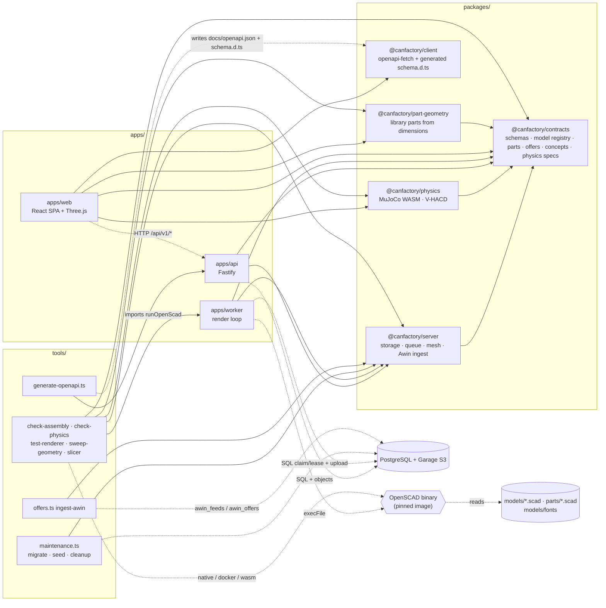
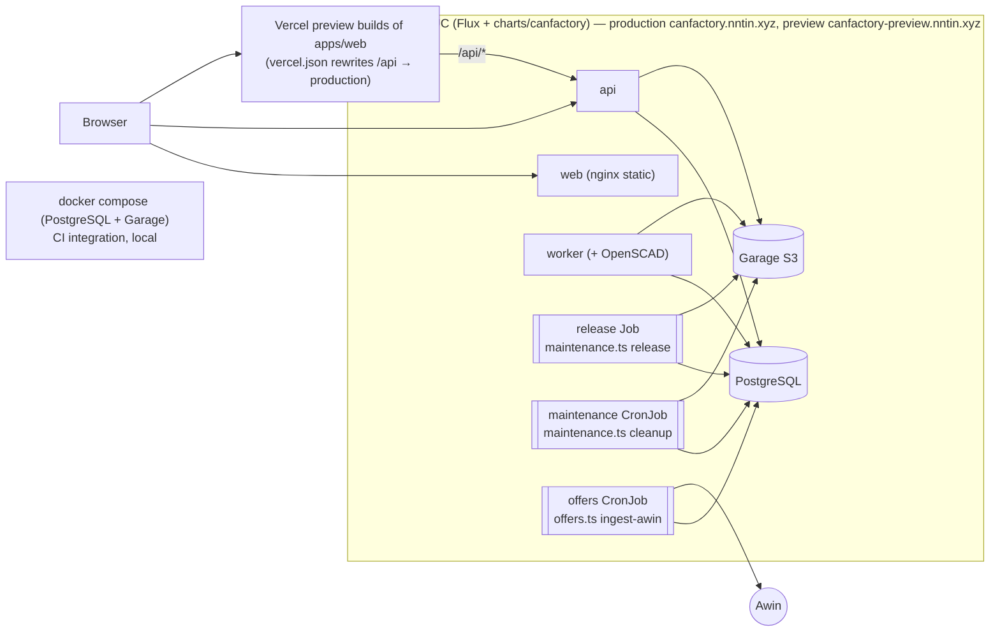

# System architecture: subsystems and how they relate

A map of the repository as it is on `develop` (2026-10-16): the workspaces under `apps/` and `packages/`, the subsystems built
on them (model library, render pipeline, parts library, affiliate offers, browser preview, physics, catio concept pages), and
the real dependencies between them. Each relationship below was checked against imports, HTTP calls, shared storage or
deployment manifests, not taken from older docs.

This file adds to the existing docs and does not replace them. Deployment details stay in
[container-architecture.md](container-architecture.md) and [kubernetes-tech-plan.md](kubernetes-tech-plan.md), the API in
[interfaces.md](interfaces.md), offers in [affiliate-offers.md](affiliate-offers.md), and physics in
[physics-plan.md](physics-plan.md).

## Goals and non-goals

This pass only maps what exists. It refactors nothing, removes no duplication and adds no abstractions. The
[findings](#known-gaps-stale-docs-and-likely-duplication) at the end are recorded for later work.

**Rule for the architecture work that follows:** the aim is to **actually reduce duplicated code**, not to add abstraction
layers. A new indirection that only hides duplication (a wrapper, an adapter or a "shared" module that the duplicate copies
still sit behind), or a layer that removes no code, does not count as progress. Measure a change by the duplicate
implementations, registrations and data copies it deletes.

## Workspaces at a glance

| Workspace | Kind | Responsibility | Depends on (imports) |
| --- | --- | --- | --- |
| `packages/contracts` | Library (pure TS, no I/O) | Holds everything as data and pure functions: TypeBox API schemas, the **model registry** (`models.ts`, `ModelDefinition`), assembly and BOM helpers, the **parts library** (`parts/`), curated **offers** and the **matcher**, **concept pages** (`concepts.ts`), and **physics mechanism specs** (`physics.ts`, `*Physics.ts`, `physicsPieces.ts`). | none (only `typebox`) |
| `packages/server` | Library (Node) | Storage and render support for the API, worker and tools: `PostgresStorage` with Garage S3 `ObjectStorage` (the only backend), `runtimeStorage()` to build it from the environment, the queue (enqueue, claim, lease, fencing, cleanup), STL inspection and repair (`mesh.ts`), the renderer fingerprint and limits (`config.ts`), and Awin feed ingest (`awin.ts`). | contracts |
| `packages/client` | Library (browser) | A typed `openapi-fetch` client over the generated `schema.d.ts`. | none (generated from the API) |
| `packages/physics` | Library (Node and browser) | MuJoCo WebAssembly physics: scene compiler (spec to MJCF), simulation, scenario runner, interactive session, V-HACD decomposition. | contracts (types and materials only) |
| `packages/part-geometry` | Library (Node and browser, Three.js) | `partGeometry(part)`: the one drawing of a procedural parts-library part, from its dimensions. The parts library, the editor's reference objects and the assembly check use it. | contracts |
| `apps/api` | Process (Fastify) | The public HTTP API: model catalogue, render jobs and artifacts, parts library, market and offers. Also serves OpenAPI. | contracts, server |
| `apps/worker` | Process (no HTTP) | Claims render jobs, runs **OpenSCAD** in a subprocess, validates the meshes, and publishes STL or ZIP artifacts. | contracts, server |
| `apps/web` | Browser SPA (React, Vite, Three.js) | Model library and editor, viewer with assembly and physics modes, parts library pages, buy list, and the catio concept pages. | client, contracts, physics, part-geometry |
| `tools/` | CLI scripts (`tsx`) | Release, migration and cleanup (`maintenance.ts`), Awin ingest (`offers.ts`), OpenAPI and client generation, renderer, storage and restart tests, geometry sweep, assembly and physics checks, slicer checks, STL-to-SCAD, preview tracking. | contracts, server, physics, part-geometry, `apps/api` (OpenAPI generation), `apps/worker` (test runners) |
| `models/` | Data (SCAD, reference STLs, fonts) | One directory per catalogue model. A model is its SCAD generator(s) plus a `ModelDefinition` in contracts. | (read by the worker and tools) |
| `parts/` | Data (SCAD and STL) | The SCAD source and STL of each part with an STL preview (an everyday object). Other parts are drawn by `packages/part-geometry`. | (read by tools; STLs bundled into web) |
| `charts/canfactory` | Helm chart | Kubernetes workloads: web, api and worker Deployments; release Job; maintenance and offers CronJobs. | (deploys the images) |

### Workspace dependency graph

Solid arrows are TypeScript imports. Dashed arrows are runtime channels (HTTP, SQL/S3, subprocess, file reads, Web Worker
messages, code generation).

Every workspace depends on `@canfactory/contracts`, and contracts depends on nothing. The API and the worker never call each
other. They share only the database and the object store. `packages/physics` never reaches the render pipeline or OpenSCAD.
The web app reaches the backend only over HTTP through `@canfactory/client`. It also bundles contracts directly, so the
browser carries its own copy of the whole model registry, parts library, offers and concept data (see
[findings](#known-gaps-stale-docs-and-likely-duplication)).

## Subsystem map

```mermaid
flowchart TB
    subgraph C["packages/contracts: data and pure logic (bundled into web, api, worker, tools)"]
        registry["Model registry<br/>models.ts: 17 ModelDefinitions<br/>schemas · controls · scadMapping · partDefines<br/>assembly · physics()"]
        reqUnion["RenderRequestSchema union<br/>index.ts: one branch per model"]
        partsLib["Parts library<br/>parts/: 24 families · sources · ids.lock"]
        offersData["Curated offers + accounts<br/>offers.ts · affiliateAccounts.ts"]
        matcher["Matcher<br/>matcher.ts: matchOffers · markets"]
        bom["BOM<br/>bom.ts: modelBom · BomLine"]
        concepts["Concept pages<br/>concepts.ts: catio hardware · ConceptPage · modelUsage"]
        phySpec["Mechanism specs<br/>physics.ts · *Physics.ts · physicsPieces.ts · spurGear.ts"]
        helpers["Model-specific geometry helpers<br/>toggleLatchMechanism · pressurePad · windowCatGuard ·<br/>printedCornerBracket · qrMagnetTag · …"]
    end

    subgraph R["Render pipeline (server side)"]
        apiRenders["api: POST /renders · GET /renders/{id}[/stl|/zip]"]
        queue[("Job queue + catalogue<br/>PostgreSQL")]
        workerR["worker: renderJob → OpenSCAD → inspectStl → publish"]
        artifacts[("Artifacts<br/>Garage S3")]
        scadFiles[("models/*/ SCAD")]
    end

    subgraph O["Affiliate offers"]
        apiOffers["api: GET /market · GET /offers"]
        awinDb[("awin_feeds · awin_offers")]
        cron[["offers CronJob<br/>tools/offers.ts → server/awin.ts"]]
        awinNet(("Awin feed API"))
    end

    subgraph W["apps/web (browser)"]
        editor["Model library + editor<br/>App.tsx · useRender.ts"]
        viewer["Viewer.tsx (Three.js)<br/>STL/ZIP + assembly slider + reference objects"]
        partGeo["@canfactory/part-geometry<br/>parts drawn from dimensions"]
        partsUi["Parts library pages<br/>PartsLibrary · PartsViewer"]
        shop["Shopping: shopping.ts · Shopping.tsx<br/>Where to buy · Hardware · buy list"]
        catio["Catio concept pages<br/>Catio*.tsx · catio*.ts (30 modules, ~7.4k lines)"]
        pworker["physicsWorker.ts (Web Worker)"]
    end

    subgraph P["packages/physics"]
        engine["build · mjcf · simulation · scenario · interactive · decompose"]
    end

    registry --> reqUnion
    registry -->|"partDefines, linked references"| partsLib
    registry --> phySpec
    registry --> helpers
    concepts --> partsLib
    concepts --> helpers
    matcher --> offersData
    offersData -->|"covers partId"| partsLib
    bom --> matcher

    editor -->|"HTTP"| apiRenders
    apiRenders --> queue
    queue --> workerR
    workerR --> scadFiles
    workerR --> artifacts
    apiRenders -->|"stream bytes"| artifacts
    registry -.->|"seed: catalogue rows + source fingerprints"| queue
    registry -.->|"findModel, validateParameters, scadDefines"| workerR

    editor --> viewer
    viewer --> partGeo
    viewer -->|"Simulate"| pworker
    pworker --> engine
    engine -->|"PhysicsSpec types, materials"| phySpec
    editor -->|"definition.physics(params), resolveAssembly"| registry

    partsUi -->|"HTTP /part-families, /parts"| partsLib
    partsUi --> partGeo

    shop -->|"HTTP"| apiOffers
    apiOffers --> matcher
    apiOffers --> awinDb
    cron --> awinNet
    cron --> awinDb
    editor -->|"modelBom"| bom
    catio -->|"BomLine → bomRequirements"| bom
    catio --> shop

    catio -->|"part dimensions, hardware ids,<br/>toggleLatchMechanism, model helpers"| concepts
    catio -->|"local Three.js geometry"| partGeo
```

### Model library and the render pipeline

- **Registration.** A model is a directory under `models/<id>/` (SCAD generator or generators, a reference STL where one is
  small and permanent, `LICENSE` and attribution) plus a `ModelDefinition` in `packages/contracts/src/models.ts`. The
  definition holds the TypeBox parameter schema, editor controls, defaults, `scadMapping` (parameter to `-D` name),
  `partDefines` (dimensions of chosen library parts passed to SCAD), and, for assemblies, `parts[]`, `assembly` or
  `assemblyForParameters`, `linkedReferences` and optionally `physics()`. Each model is registered **once**, in the
  `registeredModels` tuple (`models.ts`); `models` and the branches of `RenderRequestSchema` (`index.ts`) derive from it. After that,
  `npm run contracts:generate` regenerates `docs/openapi.json` and `packages/client/src/schema.d.ts` from the live Fastify
  routes (`tools/generate-openapi.ts` imports `apps/api/src/app.ts`). See [adding-models.md](adding-models.md).
- **Catalogue.** `store.seed()` (SQLite `Store` or `PostgresStorage`) writes one catalogue row per registered model:
  detail, `sourceFingerprint` (hash of every SCAD/asset path) and the reference object. In Kubernetes this runs in the
  release Job (`tools/maintenance.ts release`). Under Compose the API runs it at startup. `GET /api/v1/models[/{id}]` reads
  these rows.
- **Submit.** The browser (`useRender.ts`) debounces, validates locally with the same `RenderRequestSchema`, and
  `POST /api/v1/renders`. The API checks again with `findModel` and `validateParameters`, then `enqueue`s with a cache key
  built from the parameters and the model, source and renderer fingerprints. An identical unexpired job is reused.
- **Render.** `apps/worker` polls `claim()`, re-checks the model, version, fingerprint and parameters, and runs
  `openscad --backend Manifold --export-format binstl` with `-D` defines from `scadDefines()`. An assembly renders once per
  active part (identical calls are de-duplicated) and is zipped with `fflate`. Every STL goes through
  `repairFloat32Slivers`, gets an attribution stamp and passes `inspectStl` (`packages/server/src/mesh.ts`). It is then
  published with a fenced `complete()`: atomic rename locally, or an immutable S3 object plus a DB commit.
- **Deliver.** The browser polls `GET /renders/{id}` and then fetches `/stl` or `/zip`. The same bytes serve preview and
  download. The sequence diagrams in [container-architecture.md](container-architecture.md#render-request-and-stl-delivery)
  remain accurate.

### Browser preview ("live renderer")

The only geometry *renderer* is OpenSCAD in the worker. The browser *previews*:

- `Viewer.tsx` loads the rendered STL or ZIP with Three.js, places parts by the model's `Assembly` poses (assembly slider and
  motion frames come from `assembly.ts` in contracts), and adds **reference objects** (`referenceObjects.ts`). These are
  parts-library hardware drawn in Three.js from their dimensions by `@canfactory/part-geometry`, or a part's STL from `parts/`,
  bundled through `import.meta.glob`.
- Model-specific **SVG/React illustrations** (`*Illustration.tsx`, `toggleLatchMeshes.ts`) draw side views and mechanisms
  from geometry helpers in contracts (for example `toggleLatchMechanism`), not from rendered STLs.
- The same `@canfactory/part-geometry` drives the parts library's 3D preview (`PartsViewer.tsx`) and the reference objects
  that `npm run check:assembly` and `check:physics` collide.

### Parts library

- **Data:** `packages/contracts/src/parts/` has one file per family (24 families), a `schema.ts` for the shape of `Part`,
  `PartFamily` and `Dimension`, cited `sources.ts`, and `ids.lock` to keep part ids permanent. A part with an STL preview
  (an everyday object) has its SCAD and STL in `parts/<family>/`; every other part is drawn by `@canfactory/part-geometry`.
- **Served** straight from contracts by the API (`/api/v1/part-families`, `/part-families/{id}`, `/parts/{id}`) with no
  storage. Its "used by" lists come from `partUsage()`, which merges the model registry (part-linked controls and reference
  objects) with `concepts.ts` (catio pages).
- **Consumed by** the models (`partDefines` sizes SCAD from part dimensions, part-linked controls offer only parts that
  fit), by the editor's reference objects, by the physics specs (library hardware becomes exact primitives), by the catio
  pages (dimensions and hardware ids), by `tools/assembly-meshes.ts` (checks hardware as `@canfactory/part-geometry` draws it), and by the
  offers matcher (offers `cover` part ids).
- **UI:** `PartsLibrary.tsx` and `PartsViewer.tsx` at `#/parts[/family[/part]]` (hash routes in `route.ts`) show the
  "Where to buy" block from the offers subsystem.

### Affiliate links and offers

Details in [affiliate-offers.md](affiliate-offers.md). Relationships:

- **Static half (contracts):** the curated `offers.ts` (Amazon ASINs and Awin products per market, `covers` part ids),
  `affiliateAccounts.ts` (a `null` account turns a network off), `matcher.ts` (`matchOffers`, markets, URL builders), and
  `bom.ts` (`modelBom` from a model's assembly references, `bomRequirements` from catio `BomLine`s).
- **Dynamic half (server):** the `offers` CronJob (`tools/offers.ts ingest-awin` → `packages/server/src/awin.ts`) downloads
  changed Awin feeds and stores only the curated products in `awin_feeds` and `awin_offers`. Those tables exist in both
  SQLite (`packages/server/migrations/0002`) and PostgreSQL (`postgres-migrations/0002`).
- **API:** `GET /api/v1/market` (from `CF-IPCountry`) and `GET /api/v1/offers` (the matcher plus the stored Awin rows).
- **Web:** `shopping.ts` (market, offers cache and buy list in `localStorage`) and `Shopping.tsx`. The editor's "Hardware
  for this build", the parts pages' "Where to buy", the catio pages' Buy column and `#/buy-list` all use them.
- Current state: no Awin programme has accepted yet, so every curated offer is an Amazon listing and the ingest stores
  nothing useful.

### Physics engine

Status from [physics-plan.md](physics-plan.md): **implemented** (spikes 1–5 done, plus permanent magnets).

- **Spec in contracts:** `PhysicsSpec` with bodies, joints, springs, collision source, magnets and CI scenarios, plus cited
  `PHYSICS_MATERIALS`. Mechanisms sit next to their models: `springBallDetentPhysics` (models.ts), `toggleLatchPhysics`
  (toggleLatchMechanism.ts), `cigaretteCasePhysics`, `magneticCatToyPhysics`, and the `spurGear` fixture. Four catalogue
  models have `physics()`. Exact convex pieces for mechanism surfaces come from `physicsPieces.ts`, computed from the same
  numbers as the SCAD files.
- **`packages/physics`:** depends on contracts only for types and materials. Inputs are the spec, poses and mesh bytes.
  Outputs are poses, contacts and forces.
- **Interactive:** the editor's Simulate mode (`Viewer.tsx`) starts `apps/web/src/physicsWorker.ts`, a Web Worker running
  `InteractiveSession`. It receives the meshes the viewer already loaded from the render API, decomposes them with V-HACD
  and caches the result in IndexedDB.
- **CI:** `tools/physics/check-physics.ts` renders parts with OpenSCAD through `tools/assembly-meshes.ts`, then runs the
  scenarios in Node (`integration.yml` → `npm run check:physics`).
- No Kubernetes service. Physics never runs on the server.

### Catio concept pages

The catio is a **concept**, not a catalogue model: no SCAD, no render job, no physics. Routes are `#/concepts/catio`
(`CatioConcept.tsx`) and `#/concepts/catio/<window-insert|insert-tunnel-coupling|tunnel|tunnel-tunnel-coupling>`
(`CatioSubassemblyPage.tsx`).

- **Geometry is computed in the browser:** 30 `catio*.ts` and `Catio*.tsx` modules split into designs (`catioTunnel.ts`,
  `catioWindowInsert.ts`, `catioCoupling.ts`, `catioDoor.ts`, `catioPort.ts`, …) and Three.js scenes (`*Scene.ts`). They
  draw timber, mesh and hardware with `three` directly, using part dimensions (`findPart`, `dimensionOf`), hardware ids and
  helpers from `concepts.ts`, and geometry helpers of real catalogue models (`toggleLatchMechanism`, `pressurePad`,
  `printedCornerBracket`, `printedScreenHook`). `toggleLatchMeshes.ts` redraws the toggle latch in Three.js.
- **Relation to models:** `concepts.ts` lists, per sub-assembly, the catalogue models it uses (`models: ConceptModelLink[]`)
  and the library parts (`parts`). `modelUsage()` lets a model's editor link back to the catio pages, and `partUsage()` lists
  catio pages under "used by" in the parts library.
- **Relation to offers:** every sub-assembly page builds `BomLine`s, turns them into requirements with `bomRequirements`,
  and shows the Buy column and "add to buy list" through `shopping.ts`.
- **Relation to physics:** none. Neither `docs/physics-plan.md` nor `packages/physics` mentions the catio, and no catio
  module imports physics.
- **State:** per-page settings in `localStorage`, shared between pages by `catioSubassembly.ts` (`saveShared`,
  `dependentsOf`), and checked against each other (`CatioCrossPage.tsx`).

## Where data lives

| Data | Source of truth | Copies and consumers |
| --- | --- | --- |
| Model definitions, parts, offers, concepts, physics specs | `packages/contracts` source (git) | Bundled into the web JS, API, worker and tools. Model detail is also seeded into the DB catalogue. |
| SCAD generators, fonts, reference STLs | `models/`, `parts/` (git) | Packaged into the API and worker images. Reference STLs are seeded to `/data` or the Garage catalogue bucket. Part STLs are bundled into web. |
| Render jobs, leases, worker heartbeats | PostgreSQL (Kubernetes, Compose, CI and local) | api and worker only |
| Generated STLs and ZIPs (1 h TTL) | Garage `generated` bucket | Streamed by the API |
| Awin feed rows | `awin_feeds` and `awin_offers` tables | Written by the offers CronJob, read by `/offers` |
| Buy list, editor settings, catio settings | Browser `localStorage` | Browser only |
| Physics decompositions | Browser IndexedDB, `node_modules/.cache` in CI | Speed-up only |

## Deployment topology

Detailed diagrams: [container-architecture.md](container-architecture.md). The list below only adds what those diagrams
leave out, chiefly the **offers CronJob** and the **Vercel** path.

- Images (`Dockerfile`): `api` (Node; the release, maintenance and offers jobs also use the api image), `worker` (the pinned
  `openscad/openscad` image with Node copied in), and `web` (nginx plus `apps/web/dist`).
- CI: `quality.yml` (typecheck, lint, contract drift, unit tests, build), `integration.yml` (Compose stack with **SQLite**,
  Playwright, renderer, `check:assembly`, sweep sample, slicer, `check:physics`), `kubernetes.yml` (chart checks,
  `test:storage` against PostgreSQL and Garage, image and chart publication), and `geometry-sweep.yml` (nightly).

## Known gaps, stale docs and likely duplication

Noted while mapping and **not fixed here**. Each fix is a PR based on `docs/system-architecture-overview` (issues #89–#96). Candidates for the follow-up phase, judged by the
[goal above](#goals-and-non-goals): delete duplicates, don't wrap them.

### Stale or incomplete docs

1. **`docs/architecture.md` is stale.** (Tracked in #89.) It describes the localhost Docker Compose setup ("Kubernetes is a future migration
   target; the current deployment remains localhost Docker Compose", "SQLite stores the catalogue and temporary render
   jobs", "no accounts, uploads"). `container-architecture.md` and `kubernetes-tech-plan.md` record that production moved to
   Kubernetes with PostgreSQL and Garage on 2026-09-22. It also leaves out everything added since: the parts library,
   offers, physics, concept pages, and the SVG-logo and QR-code uploads in the editor.
2. **`container-architecture.md` leaves out the `offers` CronJob** (tracked in #89) (`charts/canfactory/templates/offers.yaml`), the Awin
   egress, and the Vercel preview path (`vercel.json`, which sends `/api` to production).
3. `README.md` and `interfaces.md` have no map of the subsystems. Before this file, no doc related physics, offers, parts and
   concepts to each other.

### Likely duplication to investigate

1. ~~**Two storage backends with their own queue logic.**~~ **Resolved in #90: PostgreSQL only.** `Store` (SQLite), its
   Drizzle `schema.ts` and SQL, `ArtifactStore`, `LocalStorage`, `asyncStorage()`, the `STORAGE_BACKEND` switch and the
   API's in-process maintenance loop are deleted. `PostgresStorage` with Garage S3 is the only backend, and its SQL moved to
   `packages/server/migrations/`. Compose runs PostgreSQL, Garage and the release and maintenance jobs like the chart,
   and the unit tests run against a real PostgreSQL and Garage (`tools/unit-storage.ts`).
2. ~~**Models registered twice by hand.**~~ **Resolved in #91: one registration.** The 17 hand-written
   `RenderRequestSchema` branches in `index.ts` are deleted. `RenderRequestSchema` maps over the `registeredModels` const
   tuple in `models.ts` (which `models` is), and a mapped tuple type keeps the per-model `Static<>` union.
3. ~~**Three geometries for library parts.**~~ **Resolved in #92: one drawing per family.** The twelve generic
   `parts/<family>/*.scad` files and `GENERIC_MODELS` are deleted. `partGeometry.ts` moved to `packages/part-geometry`, and
   `tools/assembly-meshes.ts` checks reference objects as it draws them, so the editor and the collision check show the same
   screw. The physics primitives stay: they are authored per mechanism in its spec, not drawn from a family's dimensions
   (`docs/physics-plan.md`, “Library hardware”).
4. **Model geometry rewritten outside SCAD.** (Tracked in #93.) The toggle latch exists in SCAD (`models/toggle-latch`), in
   `toggleLatchMechanism.ts` (contracts), in `toggleLatchMeshes.ts` and `ToggleLatchIllustration.tsx` (web), and again in the
   catio printed latch and port scenes. Other models have the same pattern (`*Illustration.tsx`, catio use of
   `printedCornerBracket` and `pressurePad`) and the tests that keep TS and SCAD values equal (for example the
   cigarette-case physics test).
5. **Several ways to run OpenSCAD** (tracked in #94): `runOpenScad` in `apps/worker/src/render.ts`, `renderScad` with native, docker and
   wasm runners in `tools/stl-to-scad/openscad.ts`, `dockerRunner` and `wasmRunner` in `tools/renderers.ts`, a second docker
   invocation in `tools/test-storage.ts`, and `tools/assembly-meshes.ts`, which repeats the worker's per-part define logic.
   `FONTS_DIR` is defined twice (`contracts/models.ts` and `tools/stl-to-scad/openscad.ts`).
6. **Mixed import styles** (tracked in #94): `tools/physics/*` and `tools/assembly-meshes.ts` import `../../packages/*/src/index.ts` by
   relative path, and `tools/stl-to-scad/openscad.ts` imports `packages/server/src/config.ts` directly. The rest of the repo
   uses `@canfactory/*`. `tools/renderers.ts` imports from `apps/worker/src/render.ts`, so an app is used as a library.
7. **Catalogue data reaches the browser two ways.** (Tracked in #95: bundled contracts survive.) The web app fetches models and parts from the API, which serves them
   from contracts (parts) or from DB rows seeded from contracts (models), and it also bundles contracts and calls
   `findModel`, `parts` and `resolveAssembly` directly. Both paths carry the same static data.
8. **Catio pages are a separate geometry stack.** (Redraws of catalogue models are tracked in #93.) About 7.4k lines of `catio*.ts` and `Catio*.tsx` build Three.js geometry by hand, separate
   from the model, render and assembly pipeline. Hardware ids sit in `concepts.ts` while designs and BOMs sit in web.
   `catioSubassembly.ts` re-exports `BomLine` and `BOM_GROUPS` from contracts.
9. **Assembly or BOM spread.** (Tracked in #96.) `modelBom` (contracts) and catio `BomLine`s (`concepts.ts` types, built in web) both end in
   `Requirement[]`, by different routes.

### Other gaps

- CI tests the SQLite path (Compose) on every PR. The PostgreSQL path is tested only in `kubernetes.yml`
  (`test:storage`).
- The Awin ingest runs hourly in Kubernetes although no Awin programme has accepted.
- `apps/web/src/styles.css` (2.3k lines) and `App.tsx` (700 lines) each hold the editor, the library and routing together.
- "Live renderer" in the request has no single module. It is the browser preview described above, built from
  `Viewer.tsx`, `partGeometry.ts`, `stage.ts` and the illustrations.
