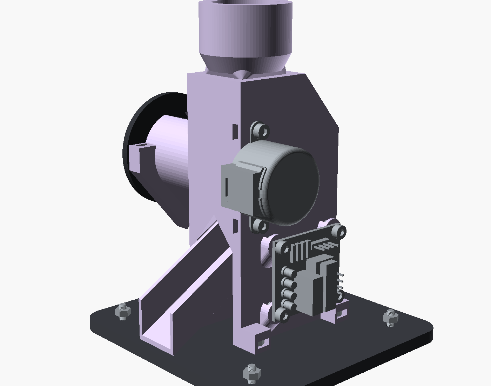
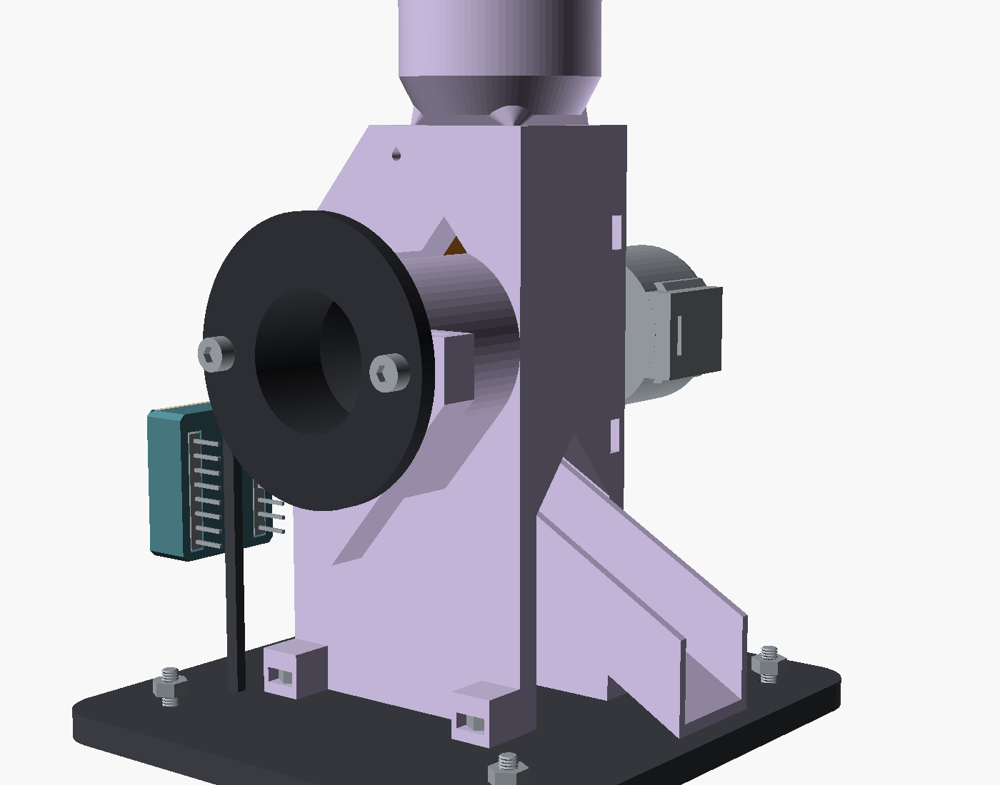
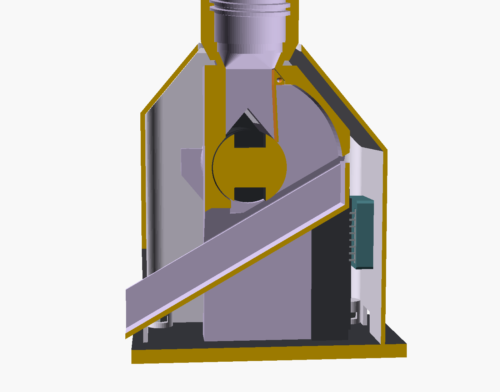
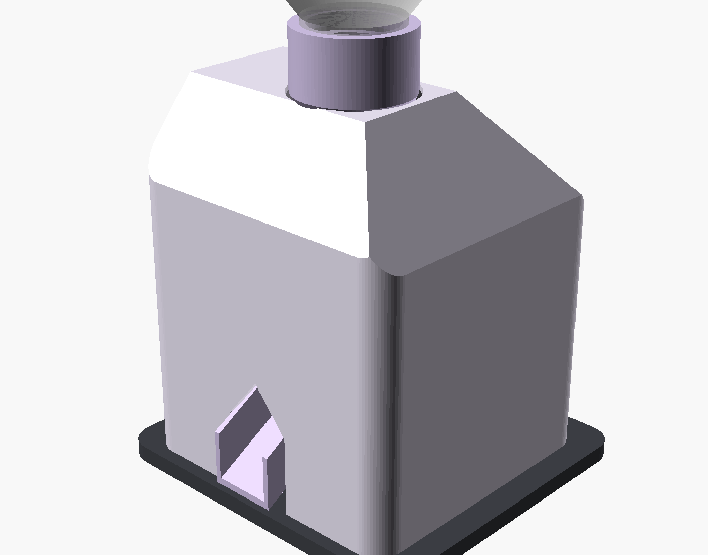
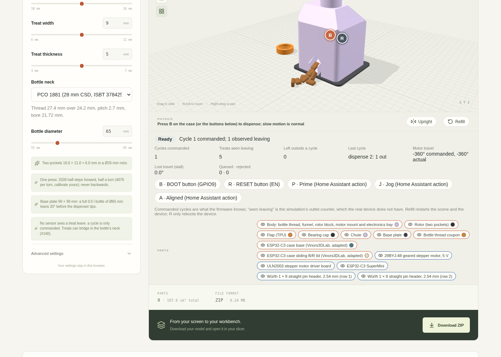

# PET-bottle treat dispenser

Model `treat-dispenser` (issue #138; the first concept is in [concepts/treat-dispenser](concepts/treat-dispenser/README.md)). A
gumball-style dispenser after bovineblitz's [Cat treat gumball-style dispenser](https://makerworld.com/en/models/190887)
([attribution](../models/treat-dispenser/ATTRIBUTION.md)): an inverted 0.5 l PET bottle screws into the top, the treats fall through
a funnel onto a horizontal rotor with two pockets, and each press of the ESP32-C3 SuperMini's BOOT button (or a Home Assistant
action) turns the rotor half a turn forwards with a 28BYJ-48, directly on its shaft. A pocket that reaches the bottom drops what it
holds onto a chute out of the front. The ULN2003 board and the SuperMini, in its existing sliding-lid case, sit inside the body; one
USB-C cable powers everything.

**Status: prototype, not validated.** Nothing here has been printed or run on hardware. A press releases **0, 1 or several
treats**: the owner accepted that (exactly one per press is not a requirement any more). What is required is that **treats do not
jam**; the simulation results below say how far that holds. Treats that **bridge in the bottle's neck** stop the flow without jamming
anything; that is issue #140, left for later.

## What is in the model

| Part | What it does |
| --- | --- |
| Inner body | The bottle's thread, a funnel into the slot, the rotor's block (bore, slot, the drop under the rotor and a cavity behind it), legs either side of the chute and four feet screwed to the base plate; the motor on the block's +X face; the ULN2003 board on four standoffs off the right leg; a sleeve carrying the bore out to the left, ending in two lugs for the bearing cap's screws. Every nut sits in a bay of its own. |
| Outer body | The cover: walls and a gable top, open at the bottom, lowered over the inner body (the thread's boss comes up through its top) and screwed to the base plate at its four corners. The ESP32 case's window in its back wall, the rotor's opening in its left wall, the chute's way out of the front. |
| Rotor | Ø26 × 24 mm, two pockets 16 × 11 × 6 mm (for 14 × 9 × 5 treats with 1 mm of clearance), a D-bore onto the motor's flatted shaft at one end, a Ø8 stub into the cap at the other. |
| Flap | 95A TPU, 0.6 mm thick: rests on the rotor just behind the slot, sprung 10° past touching, its square root block held in a recess over the cavity by a 1.75 mm filament pin through the block's left face. |
| Bearing cap | A tube through the outer body's left wall and the inner body's sleeve into the bore, up to the rotor's end, where it takes the rotor's stub; its flange sits on the wall's outside, its two M3 × 10 screws through the wall into nuts in the inner body's lugs (clamping the wall). |
| Chute | 30°, from under the rotor out through the front wall; pushed up between the legs from below and held by the base plate. |
| Base plate | 5 mm; closes the bottom; eight M3 × 8 screws from below in counterbores (four into the inner body's feet, four into the outer body's corners); sized so that a full bottle leans 20° before the dispenser tips; a keeper behind the ESP32 case. |
| Thread coupon | Ten millimetres of the body's thread: print it first and fit it to your bottle. |
| ESP32-C3 case base and lid | The existing case's two parts, unchanged ([attribution](../models/treat-dispenser/ATTRIBUTION.md)). |

Bought: a 28BYJ-48 (5 V), a ULN2003 board, an ESP32-C3 SuperMini, 16 ISO 4032 M3 hex nuts and ISO 4762 M3 screws (2 × 6 mm for the
motor, 12 × 8 mm for the ULN2003 board, the feet and the corners, 2 × 10 mm for the cap), jumper wires, and a few centimetres of 1.75
mm filament for the flap's pin. No heat-set inserts.

**Fasteners.** Every screw goes into an ISO 4032 M3 nut held in a printed bay (`treatBolts`): a hexagon 5.8 mm across its flats (the
library's 5.5 mm at its largest, 0.15 mm of play each side; 6.70 across its corners against the nut's 6.01) and 2.7 mm deep (2.4
nut), and a slot as wide as across the flats into which the nut slides from one side, so that it cannot turn. The bays open where they
can be reached: the motor's from the block's front face, the ULN2003's and the cap's from above, the feet's outwards, the corners'
from inside. Each screw and nut is a part-library reference in the assembly, at its pose, and moves in its step; the editor's
hardware list counts them.

Every dimension is computed in `packages/contracts/src/treatDispenser.ts` and passed to `models/treat-dispenser/generator.scad` as one
list (`treatScadLayout`), so the CAD, the assembly poses and the physics' collision pieces come from the same numbers; a test checks
that the generator gets every value it reads. Parameters: treat length, width, thickness and corner radius, pocket clearance, bottle
neck (PCO 1881 or PCO 1810), thread clearance and bottle diameter (65 mm, a typical 0.5 l bottle).

Frame: every part is drawn where it sits assembled (Z up, the floor at z = 0, the rotor's axis along X at y = 0, the front at −Y),
then laid on the print bed by the inverse of its pose (`treatPartPoses`).

## How it works, and why it should not jam

From the top: the bottle's neck, the funnel, a slot 16 × 17 mm over the rotor, the rotor in its bore, the drop under it, the chute.
The rotor turns **forwards only**: its top moves towards the back, so a pocket filled under the slot goes down the back, past the flap,
through the cavity, and over the drop, where its treats fall onto the chute. Each press is half a turn, so the other pocket comes up
under the slot. At rest a pocket faces up and the other down; between them the rotor closes the slot (0.4 mm of play in the bore).

Each rule below came out of a simulation that jammed (`tools/physics/treat-dispenser-trials.ts` and a replay that logs the contacts
at a stall):

- **Never backwards.** A first version rocked back 20° before each turn to shake loose a caught treat. Backwards, the slot's front edge
  is the edge a pocket leaves under, and it pinched a treat standing in the pocket every time. Forwards, the front edge only ever
  meets the rotor's closed face coming up out of the tight bore.
- **The slot's back edge is a sprung flap, not a fixed edge.** A fixed edge where the pocket leaves the slot is the same pinch. The
  TPU flap (0.03 N·mm per degree, 10° of preload) lies on the rotor and gives way to a treat that sticks out of a pocket, then closes
  behind it so that the next treats in the slot do not follow it into the cavity. A stiffer flap (0.3 N·mm/°) wedged treats near its
  root.
- **A cavity behind the flap, deeper than a treat is long** (15 mm more than the rotor's radius): a treat carried past the flap has
  room to tumble and fall to the drop; it can neither be pinched against the bore nor wedge across it.
- **The flap's root is higher than a treat standing on end in a pocket** (the rotor's radius plus the treat's length plus 2 mm above the
  axis): an edge-on treat stuck in the root's corner was the last jam found.
- **The slot is wider than a treat is long** (17 mm for 14 mm treats): a 13 mm slot let treats bridge across it over the rotor.
- **The drop and the chute are wide open**: the walls of the block stop at the block's underside, so nothing dams the drop.

What it cannot prevent: treats that arch in the bottle's 21.7 mm neck (#140) or in the funnel. That stops the flow, not the motor.

### Assembly and service

`npm run check:assembly -- treat-dispenser` passes: the assembled parts, every screw and nut, the exploded layout and every step's
path collide nowhere (also for the smallest and largest treats and the PCO 1810 neck). In order:

1. Slide the nuts into the inner body's bays: two into the motor's from the block's front face, four into the ULN2003's standoffs and
   two into the cap's lugs from above, four into the feet from the side.
2. Put the motor on the block's +X face from the side, its shaft and boss into the hole, its can in front; two M3 × 6 through its ears.
3. Screw the ULN2003 board to its standoffs under the motor (four M3 × 8), its parts facing out; plug in the motor and the jumper
   wires (IN1–IN4, + and −).
4. Push the flap up into its recess over the cavity's roof, from below, and pin it: push the filament through the hole in the
   block's left face, through the flap's root block, into the blind hole beyond; trim it flush.
5. Slide four nuts into the outer body's corner columns from inside; lower it over the inner body, the thread through its top, the
   jumper wires out through the case's window.
6. Push the chute up between the legs from below, its end through the front wall.
7. Screw the base plate on from below: four M3 × 8 into the inner body's feet, four into the outer body's corners; it holds the chute
   and stops the case from being pushed in.
8. Slide the rotor in through the left wall onto the motor's shaft; close the opening with the cap (two M3 × 10 into the lugs).
9. Plug the jumper wires onto either of the SuperMini's header rows; push the case into the back wall's window from behind, lid out,
   USB-C down.

**To clear the rotor** (a broken treat, crumbs): unscrew the cap on the left and slide the rotor out; nothing else comes apart. **To
reach the motor, the ULN2003 or the SuperMini's pins**: unscrew the bottle, the cap and the four corner screws under the base plate,
and lift the outer body off (pull the case out of its window first, or unplug its jumpers); the inner body with everything on it
stays on the base plate. To change the flap, also pull its pin.

### Packaging

105 × 101 × 131 mm assembled (without the bottle), on a 105 × 99 mm base plate: with a full 0.5 l bottle (Ø65 mm) it leans 20° before
it tips. The outer body is 89 mm wide (41.5 → 44.5 mm half width) so that the jumper plugs on the ULN2003's pins have room to the
wall, and the base plate is 5 mm thick (was 3) for the screw heads' counterbores. `tools/treat-dispenser-views.ts` renders every part
as the worker does; the solid volumes of this revision (no slicer was available when it was made, so the slicer figures below are
not re-run):

| Part | Solid volume (cm³) | Size as printed (mm) |
| --- | --- | --- |
| Inner body | 76.9 | 66 × 59 × 126 |
| Outer body | 57.6 | 89 × 87 × 108 |
| Rotor | 10.8 | 26 × 26 × 29 |
| Flap (TPU) | 0.3 | 16 × 26 × 4 |
| Bearing cap | 14.7 | 46 × 46 × 35 |
| Chute | 7.2 | 20 × 100 × 15 |
| Base plate | 53.1 | 105 × 99 × 5 (with its posts and keeper, 61 high) |
| Thread coupon | 3.8 | 34 × 34 × 10 |
| ESP32 case base and lid | 2.2 | |
| **All** | **226.8** (one body before the split: 197.9) | |

With PrusaSlicer 2.5 and `tools/treat-dispenser.ini` (0.4 mm nozzle, 0.2 mm layers, PETG, four perimeters) the single-body revision
came to 217.7 g; set `PRUSA_SLICER` to re-slice this one.

The same tool measures the **jumper wires' room** (`treatWiringRoom`) on the meshes: beyond the tips of both of the SuperMini's header
rows (by a 14 mm housing less the 6 mm it takes of a pin, and a 6 mm bend; a housing's width and 1.5 mm to each side), and beyond the
ULN2003's input pins, supply pins and motor socket, no part reaches in; it fails otherwise.

**CanFactory's parts print without supports**: every overhang is 50° or steeper (the gable top and the right side's hip, the
teardrop holes, the sleeve's teardrop section and the lugs' undersides, the chute way's ceiling, the standoffs' gussets), a short bridge (the flat strip either side of the boss's opening, 31 mm; the
cavity's round top, across its 16 mm between the side walls; the case window, 22 mm; the nut slots' ceilings, at most 5.8 mm), or the thread's own groove (1.6 mm deep). The
cavity keeps its round top on purpose: a ceiling sloped at 50° stopped the flap swinging back at about 45° and wedged treats under it
in the trials (6 stalls in 40). With automatic supports on every part the slicer added 31.8 g to the
single-body revision, most of it in the thread, from columns that would stand in the slot, the bore and the drop: switch supports off
for the inner body. For comparison, the same tool and profile gave 283.4 g (49.4 g of support) for the first notch-disc design and 233.3 g
(23.2 g) for its compact revision.

## Electrical

### Power: one USB-C cable

The SuperMini's schematic (Nologo's wiki, [image](https://wiki.nologo.tech/assets/img/esp32/esp32c3supermini/esp32c3schematicdiagram.png),
read 2026-10-21) shows the USB-C receptacle's **VBUS going straight to header H2 pin 8 (5V)**; a BAT60J Schottky diode (PD1) runs
from VBUS to VSYS, which feeds the ME6211 3.3 V regulator. So the 5V pin carries USB VBUS directly, with no fuse or diode on that path
in the schematic, and **the motor's current does not pass the diode or the regulator**. CC1 and CC2 have 5.1 kΩ pull-downs: a USB-C
source gives its default current, and the board cannot see whether it may draw more. The wiki says an external supply may feed the
5V pad (3.3 to 6 V) but never together with USB.

| Load | Value | Source |
| --- | --- | --- |
| 28BYJ-48 coil | 50 Ω ± 7 % | Kiatronics data sheet |
| ULN2003A saturation (one channel) | 0.9 V typical, 1.1 V max at 100 mA | TI ULN2003A data sheet, §5.6 |
| Coil current at 5 V | (5 − 0.9) / 50 ≈ 82 mA (73 to 88 mA over the tolerances) | from the two above |
| Motor in half steps | one or two coils on: at most ≈ 180 mA; 0 between cycles (`sleep_when_done`) | |
| ESP32-C3, Wi-Fi TX peak | 335 mA (802.11b, 1 Mbps, 21 dBm) | Espressif ESP32-C3 data sheet v2.4, current table |
| ULN2003A input | ON at ≤ 2.4 V for 200 mA (VCE = 2 V): a 3.3 V GPIO drives it | TI, §5.6 |

Peak draw, briefly: about **0.52 A** from VBUS. **Not verified**: the SuperMini's trace and connector rating (none is published; none
is invented here), the voltage drop in a cheap cable, and brown-out behaviour under a Wi-Fi burst during a step. Recommendations, not
validated: a 5 V USB-C supply of at least 1 A (not a laptop's 500 mA port), a short cable, and a 220–470 µF electrolytic capacitor
across the ULN2003 board's + and − near the board to carry the steps' current pulses. The topology is otherwise exactly the owner's:
USB-C → SuperMini → 5V/VBUS + GND → ULN2003 → motor. If the board browns out under load, that is a conflict to report, not a reason
to add a second inlet.

### Wiring

| SuperMini | ULN2003 board | Note |
| --- | --- | --- |
| 5V (H2 pin 8, VBUS) | + (5–12 V) | motor supply, straight from USB-C |
| GND | − | common ground for logic and motor |
| GPIO5 | IN1 | |
| GPIO6 | IN2 | |
| GPIO7 | IN3 | |
| GPIO10 | IN4 | |
| — | motor socket | the 28BYJ-48's keyed 5-pin XH plug (blue, pink, yellow, orange, red common) |

Avoided: GPIO2, GPIO8 and GPIO9 (strapping pins; GPIO8 is the blue LED and must be high to enter the bootloader, GPIO9 is BOOT),
GPIO18/19 (USB), GPIO20/21 (UART). GPIO5, 6, 7 and 10 are on the same header row (H1). The library does not know which ULN2003 header
pin is which on every clone: read your board's silkscreen. If the rotor turns backwards, change the firmware's `direction`.

Inside: the ESP32 case stands upright in a window in the outer body's **back wall**, its lid flush with the outside, so that **B and
R are pressable from behind**; its USB-C end points down, 25 mm over the base plate, and the cable comes in through a notch at the
foot of the back wall. **Both header rows can be wired**: the pins point into the body, and the case sits far enough left that even
the row nearer the rotor's block has a jumper plug's width and 1.5 mm beside the inner body's left face, with 14 mm free beyond the
pins' tips for the housings and the wires' bend (an earlier revision had that row against the block). Which row you use depends on
the GPIOs you choose; the default wiring above uses H1. The ULN2003 board stands on four standoffs off the **inner body's right
leg**, under the motor, its parts facing out towards the outer body's right wall, which is far enough away for the plugs on its
pins. The motor's 250 mm lead reaches it with room to spare.

### BOOT and RESET

- **BOOT (GPIO9)** is read as an input with the board's 10 kΩ pull-up, debounced 30 ms; one press runs one cycle however long it is
  held. Held down **while the chip resets**, it selects the ROM bootloader (Espressif: GPIO9 low at reset → serial download), which
  is how the board is flashed; the firmware is not running then, so it cannot dispense.
- **RESET (EN)** is the chip's enable: it always resets, never dispenses. On boot nothing moves; if a cycle was interrupted the
  firmware waits to be re-aligned.

## Firmware (ESPHome)

[`models/treat-dispenser/esphome/treat-dispenser.yaml`](../models/treat-dispenser/esphome/treat-dispenser.yaml), with
[`secrets.example.yaml`](../models/treat-dispenser/esphome/secrets.example.yaml) (copy to `secrets.yaml`; no credentials are
committed). ESP32-C3 (`variant: esp32c3`, ESP-IDF), ULN2003 stepper platform in half steps. The logic is one runner
([`treat_dispenser.h`](../models/treat-dispenser/esphome/treat_dispenser.h)) with a host test
([`treat_dispenser_test.cpp`](../models/treat-dispenser/esphome/treat_dispenser_test.cpp), 459 checks).

| Behaviour | How |
| --- | --- |
| One press, one cycle | GPIO binary sensor, `delayed_on`/`delayed_off` 30 ms, `on_press` |
| Remote | Home Assistant actions `dispense`, `prime`, `jog`, `mark_aligned`, and template buttons (Dispense, Prime, Jog forward, Mark aligned, Calibrate: 4 cycles) |
| Cycle | 2038 half-steps forwards (half a turn: the next pocket under the slot), then 500 ms for the treats to clear the chute. Never backwards. Moves are cumulative targets rounded once, so a non-integer half turn does not drift |
| One runner | dispense, prime, calibration, jog and mark-aligned all go through it; whatever conflicts with a running job is rejected and counted (`Presses rejected`), except one dispense press, which waits |
| Prime | one cycle, to fill the pocket under the slot; its treats are not counted as dispensed |
| Boot | nothing moves. "Not at rest" is written to flash and committed before every motion, "at rest" only after a cycle has run to its end: after a power cut or RESET during any motion (or on the first boot) presses are rejected until the rotor is jogged into line (a pocket facing up) and `Mark aligned` is pressed |
| Fault | a job whose step generator did not finish in time faults the device until a reboot |
| What it cannot know | whether a treat left, a jam, an empty bottle, where the rotor really is. A stalled 28BYJ-48 loses steps silently. `Cycles commanded` counts commanded motion only; it is never shown as treats dispensed |

**Calibrate** the half-steps per output turn (nominal 4096; the gear train is ≈ 1:63.68, so ≈ 4076): mark the rotor, run "Calibrate:
4 cycles" (two turns) and adjust `steps_per_turn` until it comes back to its mark. Speed: 700 half-steps/s (62° per second at the
rotor) with 2000 steps/s² of acceleration; a cycle takes about 3.8 s. Kiatronics gives the torque only at 120 Hz (in-traction
> 34.3 mN·m) and the idle start-stop rate (> 600 Hz); the torque at 700 Hz is not published. Slow down if steps are lost.

Validation: ESPHome 2026.10.0, `esphome config` is valid and `esphome compile` builds (RAM 31.8 %, flash 43.8 %). **Not run on
hardware.**

## Simulation

The editor's Simulate mode and `npm run check:physics -- treat-dispenser` simulate the assembled mechanism with MuJoCo
([physics plan](physics-plan.md#motors-and-loose-items)):

- **Only the rotor's hinge is driven**, by a torque-limited actuator (≤ 29.4 N·mm, the data sheet's 300 gf·cm pull-in torque, with
  the stiffness of one full step), directly, as the motor's shaft is. It slips like a stepper and reports the travel it lost.
- **The flap is a hinged body** at its root with a spring (0.03 N·mm per degree, at rest 10° past touching the rotor) and a little
  damping; it lies on the rotor by contact.
- **Treats are independent rounded cuboids**, 14 × 9 × 5 mm with 1.5 mm corners, 0.5 g, friction 0.4, colliding with everything and
  with each other under gravity. They are packed into the funnel and a 160 mm stand-in for the bottle's neck (its 21.7 mm bore) at the
  start (seeded, the same in the browser and CI) and never spawned, deleted or moved by a press.
- **Collision pieces keep the openings**: slot, bore, drop, cavity and chute are built from convex slabs and arcs out of the same layout
  as the CAD, and the rotor from seven pieces round its two pockets.
- **Exits are counted, not assumed**: each treat is counted once, the first time its centre crosses a plane 9 mm beyond the chute's
  end (half a treat's diagonal), so a treat still on the chute is never counted (a regression test holds a treat on a blocked chute).
  Two more counters flag any treat that reaches the electronics either side of the rotor's block.
- **The controller is the firmware's logic** (`packages/physics/src/controller.ts`): debounce, one queued press, rejection, boot
  time, RESET, re-alignment, Prime and Jog. It reports cycles commanded apart from treats seen leaving.

In the editor: **press B on the case** in the back wall (or the buttons under the viewer). The panel shows the state, cycles
commanded, treats seen leaving, treats that left outside a cycle, the motor's commanded and actual travel and any travel lost to a
stall. **Refill** restarts the scene and the device; **R** reboots only the device. It runs in slow motion (0.1 ms steps with a pile of
treats in contact).

### CI scenarios

| Scenario | Checks |
| --- | --- |
| Prime and dispense (8 treats) | after Prime and four presses: treats actually left down the chute, none between cycles, none in the electronics; four cycles commanded |
| Idle | filled and left alone for 6 s: nothing leaves, nothing strays |
| Empty bottle | Prime and two presses: nothing leaves (no fabricated success), three cycles commanded |
| Jam | a fixed obstruction (a kinematic fingertip) in a pocket: the motor stalls against it and loses travel, the cycle is a fault; the rotor does not pass through it |
| Reset | RESET mid-cycle stops the motor; boot does not move it; presses during boot and while unaligned are rejected; jog + aligned → one press runs one cycle |
| Hold and burst | BOOT held 3 s runs one cycle; three quick presses: one runs, one queues, one is rejected |

CI asserts no count per press: 0, 1 or more treats per press is the accepted behaviour.

### Simulation results

`npx tsx tools/physics/treat-dispenser-trials.ts` fills the bottle's neck and the funnel (seeded), primes, then presses eight times per
trial and counts what actually crosses the plane past the chute's end. Forty trials (2026-10-22, the final geometry): random fills,
one orientation for all treats (flat, on edge, on end, diagonal: the edge-on, diagonal and stacked fills the review asked for), and
variations of friction, mass, size, corner rounding and the number of treats; the dispenser stays sized for 14 × 9 × 5 mm treats.

| Trials | Presses | First press: 0 / 1 / 2+ | All presses: 0 / 1 / 2+ | Stalls | Leaked between cycles | Strayed into the electronics | Fastest treat |
| --- | --- | --- | --- | --- | --- | --- | --- |
| Random fills, 10 treats (6) | 48 | 0 / 2 / 4 | 26 / 10 / 12 | 0 | 0 | 0 | 0.62 m/s |
| One orientation, 10 treats (4) | 32 | 0 / 1 / 3 | 21 / 1 / 10 | 0 | 0 | 0 | 0.61 m/s |
| friction 0.3 (3) | 24 | 0 / 0 / 3 | 14 / 4 / 6 | 0 | 0 | 0 | 0.70 m/s |
| friction 0.55 (3) | 24 | 0 / 0 / 3 | 18 / 1 / 5 | 0 | 1 | 0 | 0.50 m/s |
| mass 0.3 g (3) | 24 | 0 / 0 / 3 | 19 / 2 / 3 | 0 | 1 | 0 | 0.64 m/s |
| mass 0.8 g (3) | 24 | 0 / 0 / 3 | 18 / 2 / 4 | 0 | 0 | 0 | 0.62 m/s |
| 13 × 8.5 × 4.5 (3) | 24 | 0 / 0 / 3 | 17 / 1 / 6 | 0 | 0 | 0 | 0.61 m/s |
| 15 × 9.5 × 5.5 (3) | 24 | 0 / 0 / 3 | 15 / 1 / 8 | 0 | 0 | 0 | 0.66 m/s |
| corner r 1.0 (3) | 24 | 0 / 0 / 3 | 17 / 1 / 6 | 0 | 0 | 0 | 0.62 m/s |
| corner r 2.2 (3) | 24 | 0 / 0 / 3 | 17 / 1 / 6 | 0 | 0 | 0 | 0.68 m/s |
| 6 treats (3) | 24 | 0 / 1 / 2 | 20 / 2 / 2 | 0 | 1 | 0 | 0.58 m/s |
| 12 treats (3) | 24 | 0 / 0 / 3 | 13 / 4 / 7 | 0 | 0 | 0 | 0.63 m/s |
| All (40) | 320 | 0 / 4 / 36 | 215 / 30 / 75 | 0 | 3 | 0 | 0.70 m/s |

**No stall in 320 presses**, none leaked into the electronics, and the fastest treat in the mechanism moved at 0.70 m/s (a falling
treat moves at about 1 m/s; the solver flinging one would show several): nothing was wedged and nothing was solver trouble. Three
trials lost a little travel (0.6°, 6.3° and 15.1° over all their presses, each cycle under the 10° that faults it): a treat
pressed against the flap for a moment. Three trials had one treat cross the counting plane between cycles, after the 0.5 s settle:
seen leaving, but late (why was not traced; a treat slow on the chute is the likely cause).

**0, 1 or several per press**, as accepted: the first press after Prime gives two or more in 36 of 40 trials, and then the flow
stops: 215 of 320 presses give nothing, almost all late in a trial. Replaying a fill (all on edge, seed 1) shows four treats left over sitting
still at the top of the funnel and in the bottle's neck, bridged across the 21.7 mm bore, through presses 2 to 4 while the rotor turns
freely under them; at press 5 the bridge gave way and the rest came out over the next two presses. That is the neck
bridging of issue #140, deferred; the printed parts cannot widen a PET bottle's neck.

Earlier states of this design, for the record (the same tool): with the rotor rocking back 20° before each turn, every press stalled
(the slot's front edge pinched a treat in the pocket); with a fixed back edge or a stiff flap (0.3 N·mm/°), treats wedged at the flap's
root; with a slot narrower than a treat is long, the column bridged over the rotor; with a cavity ceiling sloped at 50°, 6 stalls in 40
(the flap could not swing back far enough).

Per trial (Prime, then presses 1–8):

| Fill | Prime | Presses |
| --- | --- | --- |
| 12 treats, random 1 | 3 | 6 1 0 0 0 1 1 0 |
| 12 treats, random 2 | 1 | 5 3 2 1 0 0 0 0 |
| 12 treats, random 3 | 2 | 3 0 0 0 0 0 3 4 |
| 13 × 8.5 × 4.5, random 1 | 1 | 3 3 1 0 0 0 0 0 |
| 13 × 8.5 × 4.5, random 2 | 4 | 3 3 0 0 0 0 0 0 |
| 13 × 8.5 × 4.5, random 3 | 2 | 6 2 0 0 0 0 0 0 |
| 15 × 9.5 × 5.5, random 1 | 2 | 3 2 2 1 0 0 0 0 |
| 15 × 9.5 × 5.5, random 2 | 1 | 2 2 0 0 0 0 0 0 |
| 15 × 9.5 × 5.5, random 3 | 2 | 3 2 3 0 0 0 0 0 |
| 6 treats, random 1 | 5 | 1 0 0 0 0 0 0 0 |
| 6 treats, random 2 | 1 | 4 1 0 0 0 0 0 0 |
| 6 treats, random 3 | 1 | 5 0 0 0 0 0 0 0 |
| corner r 1.0, random 1 | 2 | 3 1 0 0 0 0 0 0 |
| corner r 1.0, random 2 | 2 | 2 4 2 0 0 0 0 0 |
| corner r 1.0, random 3 | 1 | 2 7 0 0 0 0 0 0 |
| corner r 2.2, random 1 | 1 | 4 2 0 0 0 0 0 0 |
| corner r 2.2, random 2 | 2 | 6 2 0 0 0 0 0 0 |
| corner r 2.2, random 3 | 2 | 3 4 1 0 0 0 0 0 |
| diagonal 1 | 4 | 4 0 0 2 0 0 0 0 |
| edge 1 | 5 | 1 0 0 0 0 2 2 0 |
| end 1 | 3 | 5 2 0 0 0 0 0 0 |
| flat 1 | 1 | 2 2 2 3 0 0 0 0 |
| friction 0.3, random 1 | 3 | 2 1 0 0 0 3 1 0 |
| friction 0.3, random 2 | 2 | 5 1 2 0 0 0 0 0 |
| friction 0.3, random 3 | 1 | 3 5 1 0 0 0 0 0 |
| friction 0.55, random 1 | 2 | 7 1 0 0 0 0 0 0 |
| friction 0.55, random 2 | 1 | 4 5 0 0 0 0 0 0 |
| friction 0.55, random 3 | 0 | 6 4 0 0 0 0 0 0 |
| mass 0.3 g, random 1 | 4 | 5 1 0 0 0 0 0 0 |
| mass 0.3 g, random 2 | 1 | 8 1 0 0 0 0 0 0 |
| mass 0.3 g, random 3 | 1 | 5 0 0 0 0 0 0 0 |
| mass 0.8 g, random 1 | 3 | 2 4 1 0 0 0 0 0 |
| mass 0.8 g, random 2 | 3 | 6 1 0 0 0 0 0 0 |
| mass 0.8 g, random 3 | 1 | 5 0 0 0 0 0 0 0 |
| random 1 | 5 | 1 1 1 1 1 0 0 0 |
| random 2 | 2 | 1 5 2 0 0 0 0 0 |
| random 3 | 1 | 3 2 0 0 1 3 0 0 |
| random 4 | 1 | 3 2 0 1 1 0 0 0 |
| random 5 | 2 | 2 5 1 0 0 0 0 0 |
| random 6 | 1 | 3 4 2 0 0 0 0 0 |

What the simulation leaves out: the bottle above its neck (refilling, the pile's weight), crumbs and dust, broken treats, wear,
humidity, and the TPU flap's real stiffness and creep.

## Bottle thread

The body's default thread is **PCO 1881**, the common 28 mm carbonated soft-drink finish, from ISBT's drawing 3784253-21: thread
outside diameter T 27.40 ± 0.13 mm, root E 24.20 mm, bore 21.72 ± 0.13 mm, pitch 2.70 mm, single start, right hand, 650° of full-depth
thread, support ring Ø33.0 mm. **PCO 1810** (drawing 1165362-2: T 27.43, E 24.51, bore 21.74, pitch 3.18, two turns) is the other
option. The thread is printed as the bottle's ridge grown by the thread clearance (0.3 mm default) and swept along its helix. Not
every "28 mm" bottle is either finish: **print the coupon first** and tune the clearance; nothing here claims a universal fit. The
default bottle is a 0.5 l one (Ø65 mm); the base plate is sized from it.

**The neck may bridge** (#140). The bottle's own bore (21.7 mm) is only 1.55 times the treat's length, and the printed parts cannot
change it.

## Assumptions and what is not known

| Item | Assumed | Basis |
| --- | --- | --- |
| Treat | 14 × 9 × 5 mm, corners 1.5 mm, 0.5 g, friction 0.4 on PETG | owner's size; mass, rounding and friction unmeasured (trials vary them) |
| Motor torque | 29.4 N·mm at the output, slipping beyond 0.35° of lag | Kiatronics: pull-in 300 gf·cm; > 34.3 mN·m at 120 Hz; nothing at 700 Hz |
| Steps per turn | 4076 | gear train ≈ 1:63.68 (library notes); calibrate |
| Flap | 0.6 mm 95A TPU, 0.03 N·mm per degree, 10° preload | E ≈ 26 MPa for 95A TPU (typical, not measured); a strip 0.6 × 16 × 14 mm |
| Plastic friction | 0.29 | `PHYSICS_MATERIALS` (PETG on acrylic) |
| Bottle | PCO 1881, 0.5 l, Ø65 mm | ISBT drawing; diameter is a parameter |
| Print fits | 0.4 mm rotor–bore, 0.15 mm cap in the bore, 0.3 mm thread, nut bays 0.15 mm each side across the flats and 0.3 mm deeper than the nut | typical FDM; check with the coupon and a test print |
| Jumper wires | DuPont-style housings 2.54 mm square, 14 mm long, taking 6 mm of a pin; 6 mm for the wire's bend | common jumper wires; no data sheet; measure yours |
| ULN2003 board holes | Ø3 mm: M3 screws pass | library entry (estimated from Printables 1404255); measure your board |
| USB supply | ≥ 1 A, 5 V | recommendation; the board's rating is unknown |

## Physical validation checklist

1. Measure the delivered motor, ULN2003 board and SuperMini (the library's entries flag estimated values) before printing the body.
2. Print the thread coupon; tune Thread clearance until it runs on by hand without wobble. Check that an M3 nut slides into a bay
   of a test print and does not turn in it.
3. Measure a bag of treats (largest length, width, thickness); set the parameters.
4. Print the rotor and the cap; check that the rotor turns freely in the bore by hand and slides out through the left wall.
5. Print the flap in TPU; check that it lies on the rotor with a little preload and gives way easily to a fingertip.
6. Wire as above; flash with BOOT held during reset; then check that RESET alone never moves anything.
7. Calibrate the steps per turn (4 cycles = two turns) and the direction (the rotor's top must move towards the back).
8. With USB power from a ≥ 1 A supply, run 50 cycles with Wi-Fi active: watch for resets (brown-out) and lost steps (a pocket no longer
   faces up at rest).
9. Fill the bottle; Prime over a bowl; count treats over 100 presses: how many per press, none between presses, none in the
   electronics, and **no stall**.
10. Watch the neck: do the treats arch in it (#140)?
11. Jam a treat on purpose (a broken half in a pocket): does the motor stall without breaking anything, and does clearing it through
    the cap and re-aligning work?
12. Clean it: take out the rotor, wash, reassemble. Printed plastic is not automatically food-safe.

## Open points

1. **Neck bridging** (#140): the bottle's neck arches treats and stops the flow; deferred.
2. **Power**: the 5V pin is VBUS straight from USB-C (schematic), but no current rating for the board exists; the topology stays
   single-USB as asked. A bench test under load decides it.
3. **No sensors** (as required): the device cannot tell whether a treat left, and a stall loses steps silently. An outlet or index
   sensor would be the owner's decision.
