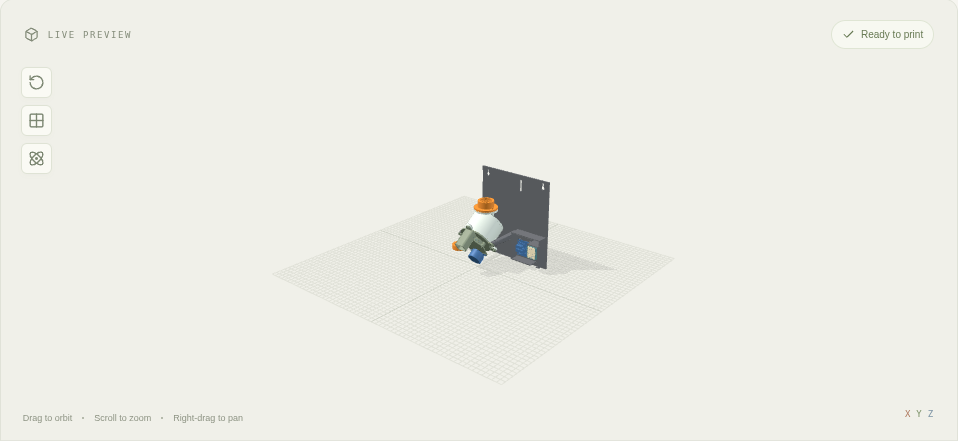

# PET-bottle treat dispenser

Model `treat-dispenser` (issue #138; concept images in [concepts/treat-dispenser](concepts/treat-dispenser/README.md)). One press
of the ESP32-C3 SuperMini's BOOT button, or a Home Assistant action, commands one dispense cycle: a quarter turn of an inclined
notch disc, which is meant to drop exactly one 14 × 9 × 5 mm rounded treat into the chute. One USB-C cable into the SuperMini powers
everything.

**Status: prototype, not validated.** Nothing here has been printed or run on hardware. The simulation shows the mechanism and the
firmware logic working, **but it does not deliver exactly one treat per press reliably**: see [Simulation results](#simulation-results)
and [Open decisions for the owner](#open-decisions-for-the-owner).

## What is in the model

| Part | What it does |
| --- | --- |
| Notch disc | Ø63 × 5 mm (for 5 mm treats), four notches 15.4 × 10.4 mm open at the rim, inclined at 55°. Lifts out of its D-bore for cleaning. |
| Spindle gear | 30 teeth, module 1, with the spindle: a round collar through the plate's bushing (the disc sits on its shoulder), a D into the disc; its back rides on the cover's pin. |
| Motor pinion | 15 teeth, module 1, on the 28BYJ-48's flatted shaft. 15:30 is a 2:1 reduction. |
| Body | Back plate (outlet hole, bushing), gearbox walls, chute, lugs for the chamber and the bracket, heat-set inserts for the cover. |
| Gearbox cover | Closes the gearbox; the motor screws to its back by its ears (M3, nuts on the gearbox side, outside its wall). |
| Chamber | Rim wall round the disc, lid, and the feed tube (Ø28 bore) from the bottle down to the low side of the disc. |
| Bottle adapter | Screws to the feed tube's flange (two M3); female bottle thread. Replaceable. |
| Thread coupon | Ten millimetres of the adapter's thread: print it first and fit it to your bottle. |
| Wall bracket | Keyholes, two arms to the plate's lugs, slots for a strap round the bottle, and the electronics bay. |
| ESP32-C3 case base and lid | The existing case's two parts, unchanged ([attribution](../models/treat-dispenser/ATTRIBUTION.md)). |

Every dimension is computed in `packages/contracts/src/treatDispenser.ts` and passed to `models/treat-dispenser/generator.scad` as one
list (`treatScadLayout`), so the CAD, the assembly poses and the physics' collision pieces come from the same numbers; a test checks
that the generator gets every value it reads. Parameters: treat length, width, thickness and corner radius, notch clearance, bottle
neck (PCO 1881 or PCO 1810), thread clearance and bottle diameter.

Frames: the disc frame D has its origin on the disc's axis in the plane of its face, +Z out of the face and +Y up the incline. The
assembled frame is D turned by `[55, 0, 180]`: the disc's face looks up and back towards the wall, the chute runs forwards and down
to the front, the motor hangs low behind the cover. Parts drawn in D are printed in their own frames (`printFrames`); the poses undo
exactly that.

## Why an inclined notch disc

The concept (#136) had a horizontal pocket rotor under a fixed lid, the edge of the inlet shearing across each pocket. Simulated, a
treat standing edge-on or diagonally in a pocket was pinched between the pocket's wall and that edge: in the simulator the contacts
blew up, and in reality a 30 mN·m stepper through a 2:1 gear would crush or wedge the treat. A fixed edge close to a moving part
inside the pile is the problem, so it was replaced:

- The **disc is inclined at 55°** and turns through the pile lying on its low side. Each notch is open at the disc's rim (closed by
  the fixed rim wall, 0.5 mm away) and as deep as a treat is thick: a treat lying flat in it is flush with the face (0.3 mm below),
  so a second treat on top of it has nothing to catch on and slides back down the incline. 65° lost treats from the notches; 45° was
  not tried.
- The notch is the treat plus 0.7 mm a side: one treat lying flat fits; beside it only 1.4 mm is left either way, so no second
  treat fits next to a flat one (checked in `treatDispenser.test.ts`). Two treats standing on edge side by side do fit
  (2 × 5 = 10 mm < 10.4 mm), 3.7 mm proud of the face and top-heavy on the incline: the geometry alone does not exclude that case.
- At the top, the notch passes over the **outlet in the back plate** (longer than the notch along the turn, reaching 2.5 mm inside its
  inner edge) and its treat drops into the chute. The cycle stops the notch over the outlet for 0.3 s, as the firmware does.
- **At rest the outlet is covered**: notches rest 45° either side of it, with at least 2 mm of plate under them (tested). There is no
  straight path from the bottle to the chute: the pile lies on the low side, the outlet is at the top, and a notch is open to it only
  while it passes.
- The **gearbox is dry**: behind the back plate, the chute's floor wall between the treats and the gear's teeth (1 mm clear of
  them; tested), and the spindle through a bushing. Crumbs can still pass the bushing's 0.2 mm play: not tested.
- **Cleaning**: lift the bottle off, unscrew the chamber (three M3), lift the disc off its spindle. The chute and outlet are open
  once the chamber is off.

### Startup: the ready procedure

From an empty disc, the notches on the way up to the outlet are empty, so the first presses would release nothing. **Prime** (a
Home Assistant action, and a button in the simulation) runs two cycles over the bowl; in the simulation it released 0 to 2 treats
from a fresh fill. After Prime, every press is meant to release one. Prime's output is not counted as dispensed.

## Electrical

### Power: one USB-C cable

The SuperMini's schematic (Nologo's wiki, [image](https://wiki.nologo.tech/assets/img/esp32/esp32c3supermini/esp32c3schematicdiagram.png),
read 2026-10-21) shows the USB-C receptacle's **VBUS going straight to header H2 pin 8 (5V)**; a BAT60J Schottky diode (PD1) runs
from VBUS to VSYS, which feeds the ME6211 3.3 V regulator. So the 5V pin carries USB VBUS directly, with no fuse or diode on that path
in the schematic, and **the motor's current does not pass the diode or the regulator**. CC1 and CC2 have 5.1 kΩ pull-downs: a USB-C
source gives its default current, and the board cannot see whether it may draw more. The wiki says an external supply may feed the
5V pad (3.3 to 6 V) but never together with USB.

| Load | Value | Source |
| --- | --- | --- |
| 28BYJ-48 coil | 50 Ω ± 7 % | Kiatronics data sheet |
| ULN2003A saturation (one channel) | 0.9 V typical, 1.1 V max at 100 mA | TI ULN2003A data sheet, §5.6 |
| Coil current at 5 V | (5 − 0.9) / 50 ≈ 82 mA (73 to 88 mA over the tolerances) | from the two above |
| Motor in half steps | one or two coils on: at most ≈ 180 mA; 0 between cycles (`sleep_when_done`) | |
| ESP32-C3, Wi-Fi TX peak | 335 mA (802.11b, 1 Mbps, 21 dBm) | Espressif ESP32-C3 data sheet v2.4, current table |
| ULN2003A input | ON at ≤ 2.4 V for 200 mA (VCE = 2 V): a 3.3 V GPIO drives it | TI, §5.6 |

Peak draw, briefly: about **0.52 A** from VBUS. **Not verified**: the SuperMini's trace and connector rating (none is published; none
is invented here), the voltage drop in a cheap cable, and brown-out behaviour under a Wi-Fi burst during a step. Recommendations, not
validated: a 5 V USB-C supply of at least 1 A (not a laptop's 500 mA port), a short cable, and a 220–470 µF electrolytic capacitor
across the ULN2003 board's + and − near the board to carry the steps' current pulses. The topology is otherwise exactly the owner's:
USB-C → SuperMini → 5V/VBUS + GND → ULN2003 → motor. If the board browns out under load, that is a conflict to report, not a reason
to add a second inlet.

### Wiring

| SuperMini | ULN2003 board | Note |
| --- | --- | --- |
| 5V (H2 pin 8, VBUS) | + (5–12 V) | motor supply, straight from USB-C |
| GND | − | common ground for logic and motor |
| GPIO5 | IN1 | |
| GPIO6 | IN2 | |
| GPIO7 | IN3 | |
| GPIO10 | IN4 | |
| — | motor socket | the 28BYJ-48's keyed 5-pin XH plug (blue, pink, yellow, orange, red common) |

Avoided: GPIO2, GPIO8 and GPIO9 (strapping pins; GPIO8 is the blue LED and must be high to enter the bootloader, GPIO9 is BOOT),
GPIO18/19 (USB), GPIO20/21 (UART). GPIO5, 6, 7 and 10 are on the same header row (H1). The library does not know which ULN2003 header
pin is which on every clone: read your board's silkscreen. If the disc turns backwards, change the firmware's `direction`.

The board sits in its case in a cradle 16 mm off the bay's floor (room for jumper wires on the header pins), its lid facing the
front so that **B and R stay pressable**, USB-C pointing down through a slot to the one cable, and the lid free to slide out
upwards. The ULN2003 board is on four standoffs (M2.5 × 8 into printed pilots) beside it. The motor's 250 mm lead reaches the bay.

### BOOT and RESET

- **BOOT (GPIO9)** is read as an input with the board's 10 kΩ pull-up, debounced 30 ms; one press runs one cycle however long it is
  held. Held down **while the chip resets**, it selects the ROM bootloader (Espressif: GPIO9 low at reset → serial download), which
  is how the board is flashed; the firmware is not running then, so it cannot dispense.
- **RESET (EN)** is the chip's enable: it always resets, never dispenses. On boot nothing moves; if a cycle was interrupted the
  firmware waits to be re-aligned.

## Firmware (ESPHome)

[`models/treat-dispenser/esphome/treat-dispenser.yaml`](../models/treat-dispenser/esphome/treat-dispenser.yaml), with
[`secrets.example.yaml`](../models/treat-dispenser/esphome/secrets.example.yaml) (copy to `secrets.yaml`; no credentials are
committed). ESP32-C3 (`variant: esp32c3`, ESP-IDF), ULN2003 stepper platform in half steps.

| Behaviour | How |
| --- | --- |
| One press, one cycle | GPIO binary sensor, `delayed_on`/`delayed_off` 30 ms, `on_press` |
| Remote | Home Assistant actions `dispense`, `prime`, `jog`, `mark_aligned`, and template buttons (Dispense, Prime, Jog forward, Mark aligned, Calibrate: 4 cycles) |
| Cycle | −1019 half-steps (the notch over the outlet), 300 ms pause, −1019 more: half a motor turn, a quarter turn of the disc |
| Busy | at most one press waits while a cycle runs; more are rejected and counted (`Presses rejected`), not silently lost |
| Boot | nothing moves; `cycle_in_progress` is kept in flash (written within 1 s): if it is set at boot, presses are rejected until the disc is jogged to its index mark (the groove on the disc and the mark on the chamber) and `Mark aligned` is pressed |
| Fault | a cycle whose step generator did not finish in time faults the device until a reboot |
| What it cannot know | whether a treat left, a jam, an empty bottle, where the disc really is. A stalled 28BYJ-48 loses steps silently. `Cycles commanded` counts commanded motion only. |

**Calibrate** the steps per output turn (nominal 4096; the gear train is ≈ 1:63.68, so ≈ 4076): mark the disc, run "Calibrate: 4
cycles" (one disc turn) and adjust `steps_per_turn` until it comes back to its mark. Speed: 700 half-steps/s with 2000 steps/s² of
acceleration. Kiatronics gives the torque only at 120 Hz (in-traction > 34.3 mN·m) and the idle start-stop rate (> 600 Hz); the
torque at 700 Hz is not published. Slow down if steps are lost.

Validation: ESPHome 2026.10.0 (latest at the time), `esphome config` is valid with no warnings and `esphome compile` builds (see the
PR for the log). **Not run on hardware.**

## Simulation

The editor's Simulate mode and `npm run check:physics -- treat-dispenser` simulate the assembled mechanism with MuJoCo
([physics plan](physics-plan.md#motors-and-loose-items)):

- **Only the pinion is driven.** The motor is a torque-limited actuator on the pinion's hinge (≤ 29.4 N·mm, the data sheet's
  300 gf·cm pull-in torque, with the stiffness of one full step), which slips like a stepper and reports the travel it lost. The disc
  turns because the gear's teeth, drawn by the same `spurGear.ts` as the printed gears, collide with the pinion's. The tooth flanks
  are frictionless (with friction two freely turning gears made the engine unstable) and the disc has 2 kg·mm² of added inertia and
  2 N·mm of bearing friction (quasi-static: they keep it from rattling in the gears' 1.2° of play).
- **Treats are independent rounded cuboids**, 14 × 9 × 5 mm with 1.5 mm corners (the hull of a sphere at each corner, sampled every
  45°), 0.5 g, friction 0.4, colliding with everything and with each other under gravity. They are packed into the chamber and the
  feed tube at the start (seeded, the same in the browser and CI) and never spawned, deleted or moved by a press.
- **Collision pieces keep the openings**: the disc is four sectors less their notches, split into wedges from each notch's centroid
  (no slivers), the plate less its outlet the same way; the chute, rim wall, lid and tube are slabs. They come from the same layout as
  the CAD. Against the rendered parts (`pieceFit`, intrusion only), the gear and pinion pieces reach 0.000 mm out of their meshes; the
  disc's 0.5 mm (its index groove; 99 % 0.000 mm); the body's 4.9 mm (99 %: 0.19 mm) where its plate pieces fill the spindle's bushing,
  which the spindle fills; the chamber's 4.0 mm (99 %: 1.5 mm) where its lid pieces span the lugs' nut traps and the tube's facets.
- **Exits are counted, not assumed**: each treat is counted once, the first time its centre crosses a plane 25 mm down the chute,
  inside the chute. A second counter flags any treat inside the gearbox.
- **The controller is the firmware's logic** (`packages/physics/src/controller.ts`): debounce, one queued press, rejection, boot time,
  RESET, re-alignment, Prime and Jog. It reports cycles commanded apart from treats seen leaving.

In the editor: **press B on the case** (or the buttons under the viewer). The panel shows the state, cycles commanded, treats seen
leaving, treats that left outside a cycle, the motor's commanded and actual travel and any travel lost to a stall. **Refill** restarts
the scene and the device; **R** reboots only the device. It runs in slow motion (the 0.1 ms steps the gear teeth need, with a pile of
treats in contact, cost about 0.4–0.6 ms each in WebAssembly).

### CI scenarios

| Scenario | Checks |
| --- | --- |
| Prime and dispense (8 treats) | after Prime and four presses: treats actually left through the chute, none between cycles, none in the gearbox; four cycles commanded |
| Idle | filled and left alone for 6 s: nothing leaves, nothing reaches the gearbox |
| Empty bottle | Prime and two presses: nothing leaves (no fabricated success), two cycles commanded |
| Jam | a fixed obstruction (a kinematic fingertip) in a notch: the disc stops at about 16°, the motor loses > 10° of travel and the cycle is a fault; the disc does not pass through it |
| Reset | RESET mid-cycle stops the motor; boot does not move it; presses during boot and while unaligned are rejected; jog + aligned → one press runs one cycle |
| Hold and burst | BOOT held 3 s runs one cycle; three quick presses: one runs, one queues, one is rejected |

CI does **not** assert exactly one treat per press, because that is not what the mechanism does yet.

### Simulation results

`npx tsx tools/physics/treat-dispenser-trials.ts` primes and then presses eight times per trial, counting what actually crosses the
outlet. Twelve trials were run (2026-10-21; a full run is 40 trials and about two hours on 6 cores; the rest, the treat-variation
groups, were cut short and are still to run):

| Trials (10 treats each) | Presses | Exactly one | None | Two |
| --- | --- | --- | --- | --- |
| Random fills, seeds 1–6 | 48 | 27 | 15 | 6 |
| One orientation (flat, edge, end, diagonal), seed 1 | 32 | 19 | 12 | 1 |
| Treat friction 0.3, seeds 1–2 | 16 | 10 | 4 | 2 |
| **All** | **96** | **56 (58 %)** | **31 (32 %)** | **9 (9 %)** |

Prime released 0 to 2 treats. In every trial: **no treat left between cycles, none reached the gearbox, the motor lost no steps**.
Ten treats run low by the last presses (the bottle is not simulated; see below), which adds empties late; over the first four presses
of each trial it is 29 of 48 exactly one (60 %), 12 none, 7 two. Per trial (presses 1–8):

| Fill | Prime | Presses |
| --- | --- | --- |
| random 1 | 2 | 0 1 1 1 0 1 1 1 |
| random 2 | 1 | 1 0 1 1 1 0 1 0 |
| random 3 | 0 | 2 1 0 1 0 0 0 0 |
| random 4 | 1 | 2 0 2 0 1 1 1 0 |
| random 5 | 0 | 2 1 2 1 1 1 1 0 |
| random 6 | 0 | 1 2 1 0 1 1 1 1 |
| flat 1 | 1 | 1 1 0 1 1 0 1 1 |
| edge 1 | 1 | 1 1 0 1 2 1 0 0 |
| end 1 | 1 | 1 1 0 1 0 0 0 0 |
| diagonal 1 | 0 | 0 1 1 1 0 1 1 1 |
| friction 0.3, random 1 | 1 | 2 1 1 0 1 1 1 1 |
| friction 0.3, random 2 | 1 | 1 1 0 1 2 1 0 0 |

**The requirement (exactly one per press) is not met.** Watching the runs: most treats in the pile lie on edge or across a notch
rather than flat in it, so a notch often rises empty; and the turning face drags the pile up the rising side against the rim wall,
so the notch passing the top sometimes takes a second treat (or one rides on the first). The variants tried in the prototype (six
notches, a longer outlet reaching further in, a pause over it, 65°, slower motion; a few trials each, not this study) did no better;
none came near 100 %. Four notches were chosen because six left too little plate between the outlet and the resting notches. The simulation is finite and soft-contact: 100 % in it would not have proven the real device either.

What the simulation leaves out: the bottle above the feed tube (the pile's weight on the tube, refilling), crumbs and dust, the
treats' variation in a bag (the trials' size and mass variations did not run), wear, and humidity.

## Bottle thread

The adapter's default is **PCO 1881**, the common 28 mm carbonated soft-drink finish, from ISBT's drawing 3784253-21: thread
outside diameter T 27.40 ± 0.13 mm, root E 24.20 mm, bore 21.72 ± 0.13 mm, pitch 2.70 mm, single start, right hand, 650° of full-depth
thread, support ring Ø33.0 mm. **PCO 1810** (drawing 1165362-2: T 27.43, E 24.51, bore 21.74, pitch 3.18, two turns) is the other
option. The thread is printed as the bottle's ridge grown by the thread clearance (0.3 mm default) and swept along its helix. Not
every "28 mm" bottle is either finish: **print the coupon first** and tune the clearance; nothing here claims a universal fit.

**The neck may bridge.** The bottle's own bore (21.7 mm) is only 1.55 times the treat's length; in an early simulation a column of
treats in a 21.7 mm tube jammed (8 of 12 stayed up). The feed tube below the adapter is wider (28 mm), but the bottle's neck cannot
be. Test with real treats: if they arch in the neck, a wide-mouth container or an agitator is needed.

## Assumptions and what is not known

| Item | Assumed | Basis |
| --- | --- | --- |
| Treat | 14 × 9 × 5 mm, corners 1.5 mm, 0.5 g, friction 0.4 on PETG | owner's size; mass, rounding and friction unmeasured (trials vary them) |
| Motor torque | 29.4 N·mm at the output, slipping beyond 0.35° of lag | Kiatronics: pull-in 300 gf·cm; > 34.3 mN·m at 120 Hz; nothing at 700 Hz |
| Motor inertia | 0.2 g·m² at the output | assumed (stable simulation), not measured |
| Steps per turn | 4076 | gear train ≈ 1:63.68 (library notes); calibrate |
| Plastic friction | 0.29 | `PHYSICS_MATERIALS` (PETG on acrylic) |
| Bottle | PCO 1881, Ø90 mm (1.5 l) | ISBT drawing; diameter is a parameter |
| Print fits | 0.2 mm disc–spindle, 0.15 mm pinion bore, 0.3 mm thread | typical FDM; check with the coupon and a test print |
| USB supply | ≥ 1 A, 5 V | recommendation; the board's rating is unknown |

## Physical validation checklist

1. Measure the delivered motor, ULN2003 board and SuperMini (the library's entries flag estimated values) before printing the body,
   cover and bracket.
2. Print the thread coupon; tune Thread clearance until it runs on by hand without wobble.
3. Measure a bag of treats (largest length, width, thickness); set the parameters; check that two cannot sit in one notch.
4. Print the disc, gear and pinion; check the gear mesh by hand (no binding, little play) and the disc's 0.3 mm over the plate.
5. Wire as above; flash with BOOT held during reset; then check that RESET alone never moves anything.
6. Calibrate the steps per turn (4 cycles = one disc turn) and the direction.
7. With USB power from a ≥ 1 A supply, run 50 cycles with Wi-Fi active: watch for resets (brown-out) and lost steps (the index marks
   drift).
8. Fill the bottle; Prime over a bowl; count treats over 100 presses: one per press? None between presses? Crumbs in the gearbox?
9. Try the bottle's neck: do the treats arch in it?
10. Jam a treat on purpose (a broken half): does the motor stall without breaking anything, and does re-alignment work after a reset?
11. Clean it: disassemble, wash, reassemble. Printed plastic is not automatically food-safe.

## Open decisions for the owner

1. **Exact-one is not met in simulation** (see the results): treats in the pile mostly lie on edge or across a notch, so presses come
   out empty, and the rotating face drags the pile up the rising side, so a notch near the top sometimes takes a second treat. Options:
   (a) an **outlet sensor** (an IR break-beam across the chute) so the firmware repeats a cycle until one treat is seen and stops on a
   second, (b) an **index sensor** (a hall sensor and a magnet in the disc) for homing after a reset, (c) a different singulator (a
   vertical magazine with a pusher, which needs the treats to arrive flat), (d) further geometry work on this one (a hood over the
   upper disc, notch lead-ins, agitation). No sensor or hardware has been added: that needs your decision.
2. **Power**: the 5V pin is VBUS straight from USB-C (schematic), but no current rating for the board exists; the topology stays
   single-USB as asked. A bench test under load decides it.
3. **Neck bridging**: a PET bottle's 21.7 mm neck may arch 14 mm treats; a wide-mouth container may be needed.
